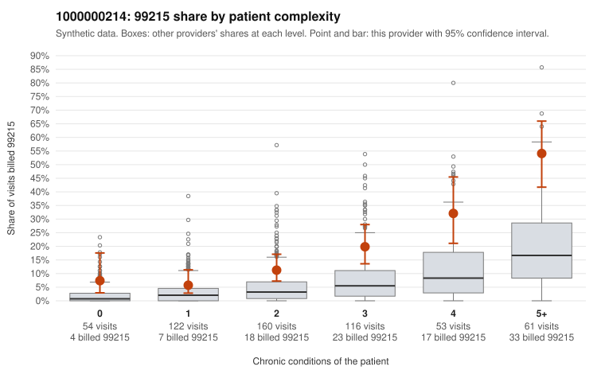

# 1000000214: Provider 1000000214 bills 99215 at roughly 2.5 times the all-provider rate in every complexity stratum, but the few returned charts support the billed levels, so the pattern is not resolved either way.

**Leaning (advisory):** Inconclusive

## Why

1000000214 billed 99215 on 18.0% of 566 claims against an expected 4.8% given patient complexity (risk-adjusted score 5.02; plain z-score vs peers 2.46). 11% of this provider's 99215 claims were on patients with 0 or 1 chronic conditions. Records came back for 29 claims. Of 6 documented 99215 claims, 0 (0%) were documented below the billed level, against 0% for the comparison providers. Note checks on 29 returned notes (share showing each sign): problems 14%, late 3%, unsigned 0%, data 14%. No audit trail was received. 4 of 23 notes claiming moderate-or-higher data reviewed had no lab or test line on the claim. The by-complexity table shows the 99215 share elevated at every condition count, from 0 conditions to 5+, so a sicker panel does not explain the excess, and the mix also leans heavily on 99214. The documentation does not confirm upcoding: all six documented 99215 claims supported the billed level. Six charts is too thin to rule out inflated notes, though. Several note signals deserve attention: the time-repeat and problem-list flags, the 4 notes claiming moderate-plus data review with no lab or test line on the claim, and the missing audit trail. Claim C0108812 is worth a close look because it is a single-condition hypertension visit documented as high MDM at 50 minutes and also appears among the problem-flagged notes. The reviewer should first request more charts, prioritizing the low-complexity 99215 claims in the packet (for example C0108863, C0109028 and C0109351) and a sample of 99214s, and should obtain the EHR audit trail to check whether these notes are templated or cloned. Examples: C0108966: billed 99214; documented MDM level low, minutes not recorded. C0108812: billed 99215, patient aged 44 with 1 chronic condition(s) (hypertension); documented MDM level high, 50 minutes. C0108827: billed 99215, patient aged 48 with 1 chronic condition(s) (obesity).

## Evidence chart

## Cited claims

`C0108966`, `C0108812`, `C0108827`

## Suggested next steps

- 29 charts came back but do not settle it: request a targeted sample of 99215 charts, starting with C0108966, C0108812, C0108827.
- Re-check after the targeted charts arrive; do not call upcoding or a sicker panel on this evidence alone.

---
Citations checked: 3/3 valid. Synthetic data. The leaning is advisory; the flag comes from the statistical screen, and no clinical documentation is available beyond the sampled records-review facts shown in the packet.
