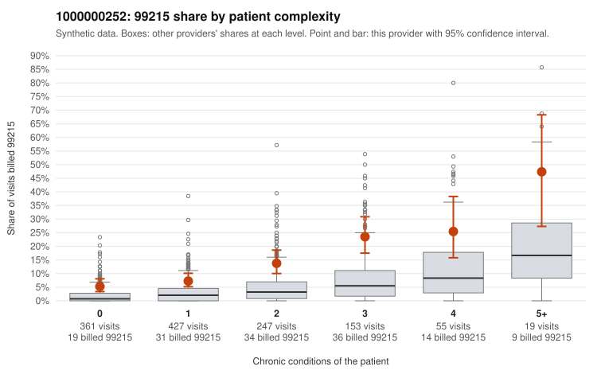

# 1000000252: Provider 1000000252's 99215 rate is well above expected in every complexity tier, including many simple visits, yet every returned 99215 chart supported the billed level, so the evidence conflicts.

**Leaning (advisory):** Inconclusive

## Why

1000000252 billed 99215 on 11.3% of 1,262 claims against an expected 2.7% given patient complexity (risk-adjusted score 6.34; plain z-score vs peers 1.21). 35% of this provider's 99215 claims were on patients with 0 or 1 chronic conditions. Records came back for 45 claims. Of 17 documented 99215 claims, 0 (0%) were documented below the billed level, against 0% for the comparison providers. Note checks on 45 returned notes (share showing each sign): problems 24%, late 2%, unsigned 0%, data 2%. No audit trail was received. 2 of 32 notes claiming moderate-or-higher data reviewed had no lab or test line on the claim. The billing pattern points toward upcoding. The 99215 share runs roughly two to three times the all-provider share in every complexity stratum, not just among sicker patients, and the sampled low-complexity 99215 claims include routine-looking presentations such as back pain, UTI and abdominal pain (e.g., C0129314, C0129460, C0129499). The documentation points the other way. All 17 documented 99215 claims supported the billed level (e.g., C0128541, C0129614), and only 2 of the 32 notes claiming moderate-or-higher data review lacked a test line on the claim, so cloned data review looks unlikely. However, the records cover only a small slice of claims, the 24% problems-signal rate and the repeated-time flags (9%) hint that notes may be built up to match the billed level, and no audit trail was received. A reviewer should first request charts specifically for the low-complexity 99215 claims listed, such as C0128713, C0129182, C0129256 and C0129448, and check whether the documented problems and MDM fit a 0–1 condition visit for back pain or UTI. They should also obtain the EHR audit trail to rule out templated or pasted note content. Examples: C0128529: billed 99215, patient aged 41 with 1 chronic condition(s) (hypothyroidism). C0128559: billed 99215, patient aged 46 with 1 chronic condition(s) (hypertension).

## Evidence chart

## Cited claims

`C0128529`, `C0128559`

## Suggested next steps

- 45 charts came back but do not settle it: request a targeted sample of 99215 charts, starting with C0128529, C0128559.
- Re-check after the targeted charts arrive; do not call upcoding or a sicker panel on this evidence alone.

---
Citations checked: 2/2 valid. Synthetic data. The leaning is advisory; the flag comes from the statistical screen, and no clinical documentation is available beyond the sampled records-review facts shown in the packet.
