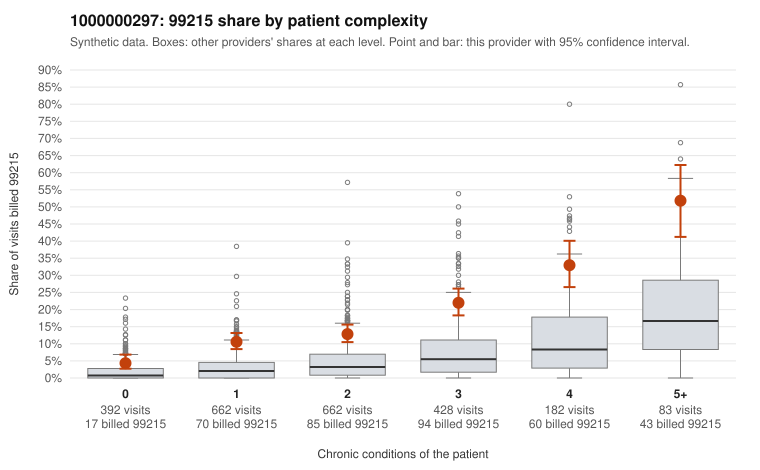

# 1000000297: Provider 1000000297 bills 99215 well above expectation in every complexity band, but its small set of returned 99215 charts all support the billed level, so the pattern is unresolved.

**Leaning (advisory):** Inconclusive

## Why

1000000297 billed 99215 on 15.3% of 2,409 claims against an expected 3.6% given patient complexity (risk-adjusted score 10.67; plain z-score vs peers 1.96). 24% of this provider's 99215 claims were on patients with 0 or 1 chronic conditions. Records came back for 45 claims. Of 17 documented 99215 claims, 0 (0%) were documented below the billed level, against 0% for the comparison providers. Note checks on 45 returned notes (share showing each sign): problems 13%, late 7%, unsigned 0%, data 4%. No audit trail was received. 3 of 32 notes claiming moderate-or-higher data reviewed had no lab or test line on the claim. The excess 99215 billing is not confined to the sicker patients: in every complexity band the 99215 share runs about two to three times the all-provider share, including patients with zero or one chronic condition. Many of the sampled low-complexity 99215 claims carry only simple diagnoses such as back pain (M54.50), rash (R21) or upper respiratory infection (J06.9), which is the part of the pattern that looks like upcoding. Against that, all 17 documented 99215 claims were supported, including low-complexity claim C0154784 (back pain only, documented high MDM, 42 minutes). Records cover under 2% of claims, and the note checks show some problem flags and repeated time entries but no audit trail, so the documentation could be accurate or could be templated to match the billed level. A reviewer should first request charts targeted at the low-complexity 99215 claims listed in the packet, along with the EHR audit trail, and confirm whether the high-MDM notes such as C0154784 reflect genuine work or cloned content. Examples: C0152933: billed 99213; documented MDM level straightforward, 13 minutes. C0155269: billed 99214; documented MDM level low, minutes not recorded. C0152835: billed 99215, patient aged 38 with 1 chronic condition(s) (type 2 diabetes). C0153075: billed 99215, patient aged 60 with 1 chronic condition(s) (asthma).

## Evidence chart

## Cited claims

`C0152933`, `C0155269`, `C0152835`, `C0153075`

## Suggested next steps

- 45 charts came back but do not settle it: request a targeted sample of 99215 charts, starting with C0152933, C0155269, C0152835.
- Re-check after the targeted charts arrive; do not call upcoding or a sicker panel on this evidence alone.

---
Citations checked: 4/4 valid. Synthetic data. The leaning is advisory; the flag comes from the statistical screen, and no clinical documentation is available beyond the sampled records-review facts shown in the packet.
