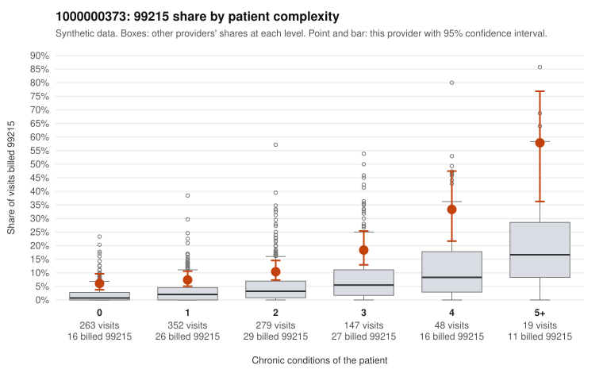

# 1000000373: Provider 1000000373 bills 99215 well above risk-adjusted expectation across every complexity band, but the records review is too thin to confirm or rule out upcoding.

**Leaning (advisory):** Inconclusive

## Why

1000000373 billed 99215 on 11.3% of 1,108 claims against an expected 2.9% given patient complexity (risk-adjusted score 5.61; plain z-score vs peers 1.20). 34% of this provider's 99215 claims were on patients with 0 or 1 chronic conditions. Records came back for 25 claims. Of 9 documented 99215 claims, 2 (22%) were documented below the billed level, against 0% for the comparison providers. Note checks on 25 returned notes (share showing each sign): problems 20%, late 4%, unsigned 0%, data 0%. No audit trail was received. 2 of 19 notes claiming moderate-or-higher data reviewed had no lab or test line on the claim. The elevated 99215 share holds in every complexity band, including patients with zero or one chronic condition. About a third of 99215s fall on low-complexity patients, and the low-complexity sample includes routine-looking diagnoses such as Z09 follow-ups, M54.50 low back pain and J06.9 upper respiratory infection (e.g., C0186381, C0186772, C0187375). That pattern is more consistent with upcoding than with a sicker panel. Against this, the documentation is thin: only 9 documented 99215 claims, with 2 below the billed level (C0186620, C0187083) and several supported at high MDM (C0186359, C0186867, C0187407), so the unsupported rate sits between the rule's cutoffs and cannot settle the question. The note signals are modest: the problem flags are worth a look (C0187083 also appears among the below-billed claims), and there are a few no-lab notes claiming moderate-or-higher data reviewed, which is weak evidence at most, while the missing audit trail leaves cloning or bulk creation untested. A reviewer should first request more charts, prioritizing 99215 claims on 0–1 condition patients from the low-complexity sample, along with the audit trail, to see whether the documented MDM actually supports the billed level. Examples: C0186620: billed 99215; documented MDM level moderate, minutes not recorded. C0187083: billed 99215, patient aged 70 with 0 chronic condition(s); documented MDM level moderate, minutes not recorded. C0186270: billed 99215, patient aged 49 with 1 chronic condition(s) (type 2 diabetes). C0186347: billed 99215, patient aged 47 with 1 chronic condition(s) (depression).

## Evidence chart

## Cited claims

`C0186620`, `C0187083`, `C0186270`, `C0186347`

## Suggested next steps

- 25 charts came back but do not settle it: request a targeted sample of 99215 charts, starting with C0186620, C0187083, C0186270.
- Re-check after the targeted charts arrive; do not call upcoding or a sicker panel on this evidence alone.

---
Citations checked: 4/4 valid. Synthetic data. The leaning is advisory; the flag comes from the statistical screen, and no clinical documentation is available beyond the sampled records-review facts shown in the packet.
