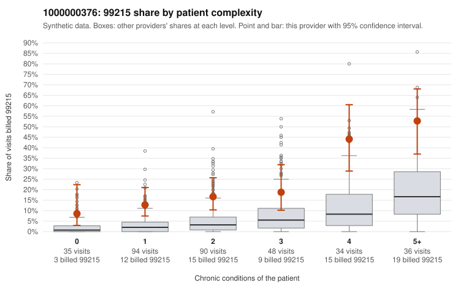

# 1000000376: Provider 1000000376 bills 99215 well above expectation in every complexity group, but the 20 sampled 99215 charts all support the billed level, so the evidence is split.

**Leaning (advisory):** Inconclusive

## Why

1000000376 billed 99215 on 21.7% of 337 claims against an expected 4.6% given patient complexity (risk-adjusted score 5.11; plain z-score vs peers 3.15). 21% of this provider's 99215 claims were on patients with 0 or 1 chronic conditions. Records came back for 45 claims. Of 20 documented 99215 claims, 0 (0%) were documented below the billed level, against 0% for the comparison providers. Note checks on 45 returned notes (share showing each sign): problems 24%, late 9%, unsigned 0%, data 7%. No audit trail was received. 5 of 34 notes claiming moderate-or-higher data reviewed had no lab or test line on the claim. The excess 99215 share persists after risk adjustment and appears in every complexity band, including patients with 0–1 conditions (e.g., C0187843 for J06.9 alone, C0188038 for Z09 alone). A sicker panel would not explain that, and it points toward upcoding. Against this, none of the 20 documented 99215 claims were documented below the billed level. That would normally favor a legitimately complex practice, though records cover only a small share of claims. The documentation also carries soft warning signs: about a quarter of notes flagged on problems, and 5 notes claiming moderate-or-higher data review had no lab or test line on the claim. C0188086 stands out as a one-condition 99215 (E11.9;Z09) documented at high MDM and listed among the data-flag examples, which is consistent with notes possibly inflated to match billing rather than proof of it. A reviewer should first examine C0188086 and the other low-complexity 99215s against their charts, request the missing audit trail to check for cloned or templated notes, and expand the records sample toward low-complexity 99215 claims. Examples: C0188087: billed 99214; documented MDM level low, minutes not recorded. C0187843: billed 99215, patient aged 42 with 0 chronic condition(s). C0187869: billed 99215, patient aged 39 with 1 chronic condition(s) (hypertension).

## Evidence chart

## Cited claims

`C0188087`, `C0187843`, `C0187869`

## Suggested next steps

- 45 charts came back but do not settle it: request a targeted sample of 99215 charts, starting with C0188087, C0187843, C0187869.
- Re-check after the targeted charts arrive; do not call upcoding or a sicker panel on this evidence alone.

---
Citations checked: 3/3 valid. Synthetic data. The leaning is advisory; the flag comes from the statistical screen, and no clinical documentation is available beyond the sampled records-review facts shown in the packet.
