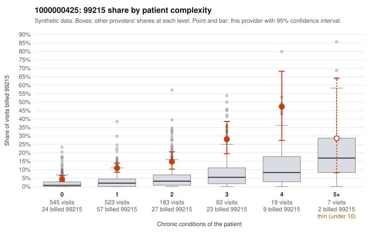

# 1000000425: 99215 use is far above expectation and concentrated on low-complexity patients, but every documented 99215 chart supports the billed level, and widespread duplicate note text weakens that support.

**Leaning (advisory):** Inconclusive

## Why

1000000425 billed 99215 on 10.4% of 1,359 claims against an expected 2.1% given patient complexity (risk-adjusted score 7.31; plain z-score vs peers 1.04). 57% of this provider's 99215 claims were on patients with 0 or 1 chronic conditions. Records came back for 45 claims. Of 17 documented 99215 claims, 0 (0%) were documented below the billed level, against 0% for the comparison providers. Note checks on 45 returned notes (share showing each sign): problems 51%, late 0%, unsigned 0%, data 7%, bulk created 0%, paste heavy 0%. 3 of 35 notes claiming moderate-or-higher data reviewed had no lab or test line on the claim. The billing side points toward upcoding: 99215 share is elevated in every complexity stratum, and more than half of the 99215s fall on patients with zero or one chronic condition. Sampled examples include acute or follow-up diagnoses such as J06.9, R21 and Z09. The documentation points the other way, since all 17 documented 99215 claims supported the billed level. However, that rests on charts for only a small share of claims, and most returned notes were flagged as duplicates, which raises the possibility that cloned notes are propping up the billed levels. For example, C0214752 (a 25-year-old with no chronic conditions and a Z09 follow-up code) is documented at high MDM, which deserves a closer look. A reviewer should first compare the duplicate-flagged notes across patients for templated MDM and problem lists, then request a larger chart sample targeted at low-complexity 99215 claims. Examples: C0213629: billed 99214; documented MDM level low, 27 minutes. C0214544: billed 99214; documented MDM level low, minutes not recorded. C0213439: billed 99215, patient aged 47 with 0 chronic condition(s). C0213456: billed 99215, patient aged 63 with 1 chronic condition(s) (hyperlipidemia).

## Evidence chart

## Cited claims

`C0213629`, `C0214544`, `C0213439`, `C0213456`

## Suggested next steps

- 45 charts came back but do not settle it: request a targeted sample of 99215 charts, starting with C0213629, C0214544, C0213439.
- Re-check after the targeted charts arrive; do not call upcoding or a sicker panel on this evidence alone.

---
Citations checked: 4/4 valid. Synthetic data. The leaning is advisory; the flag comes from the statistical screen, and no clinical documentation is available beyond the sampled records-review facts shown in the packet.
