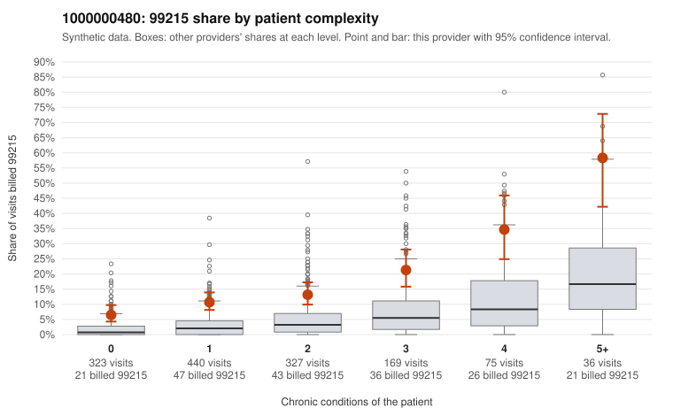

# 1000000480: 1000000480: too few returned records to judge

**Leaning (advisory):** Inconclusive

## Why

1000000480 billed 99215 on 14.2% of 1,370 claims against an expected 3.1% given patient complexity (risk-adjusted score 8.15; plain z-score vs peers 1.74). 35% of this provider's 99215 claims were on patients with 0 or 1 chronic conditions. Records came back for 45 claims. Of 19 documented 99215 claims, 0 (0%) were documented below the billed level, against 0% for the comparison providers. Note checks on 45 returned notes (share showing each sign): problems 20%, late 4%, unsigned 0%, data 4%. No audit trail was received. 2 of 32 notes claiming moderate-or-higher data reviewed had no lab or test line on the claim. The evidence does not support a call either way yet. Examples: C0246251: billed 99214; documented MDM level low, minutes not recorded. C0245131: billed 99215, patient aged 35 with 0 chronic condition(s). C0245277: billed 99215, patient aged 69 with 0 chronic condition(s).

## Evidence chart

## Cited claims

`C0246251`, `C0245131`, `C0245277`

## Suggested next steps

- 45 charts came back but do not settle it: request a targeted sample of 99215 charts, starting with C0246251, C0245131, C0245277.
- Re-check after the targeted charts arrive; do not call upcoding or a sicker panel on this evidence alone.

---
Citations checked: 3/3 valid. Synthetic data. The leaning is advisory; the flag comes from the statistical screen, and no clinical documentation is available beyond the sampled records-review facts shown in the packet.
