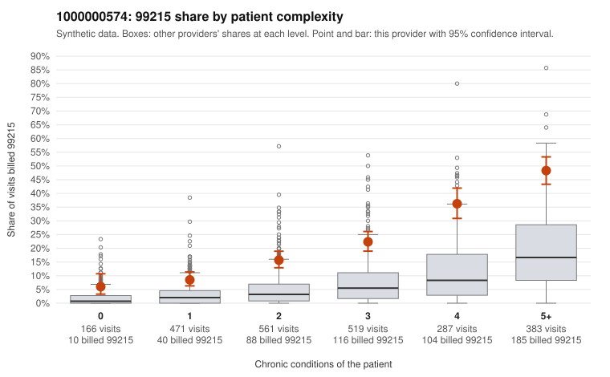

# 1000000574: 1000000574: too few returned records to judge

**Leaning (advisory):** Inconclusive

## Why

1000000574 billed 99215 on 22.7% of 2,387 claims against an expected 5.7% given patient complexity (risk-adjusted score 12.50; plain z-score vs peers 3.35). 9% of this provider's 99215 claims were on patients with 0 or 1 chronic conditions. Records came back for 33 claims. Of 17 documented 99215 claims, 0 (0%) were documented below the billed level, against 0% for the comparison providers. Note checks on 33 returned notes (share showing each sign): problems 9%, late 0%, unsigned 0%, data 3%. No audit trail was received. 1 of 26 notes claiming moderate-or-higher data reviewed had no lab or test line on the claim. The evidence does not support a call either way yet. Examples: C0296357: billed 99215, patient aged 58 with 1 chronic condition(s) (type 2 diabetes). C0296378: billed 99215, patient aged 29 with 0 chronic condition(s).

## Evidence chart

## Cited claims

`C0296357`, `C0296378`

## Suggested next steps

- 33 charts came back but do not settle it: request a targeted sample of 99215 charts, starting with C0296357, C0296378.
- Re-check after the targeted charts arrive; do not call upcoding or a sicker panel on this evidence alone.

---
Citations checked: 2/2 valid. Synthetic data. The leaning is advisory; the flag comes from the statistical screen, and no clinical documentation is available beyond the sampled records-review facts shown in the packet.
