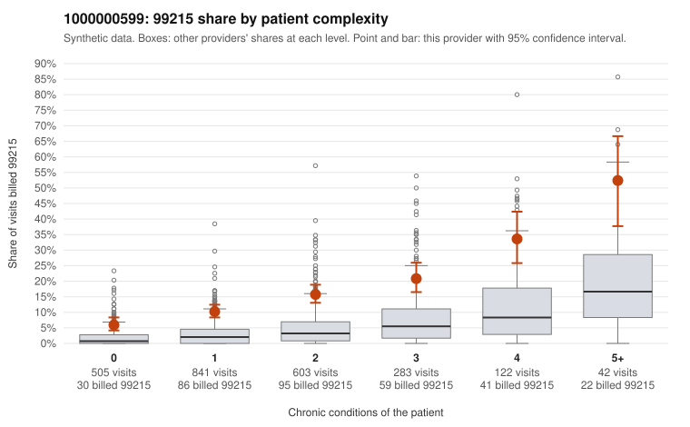

# 1000000599: 1000000599: too few returned records to judge

**Leaning (advisory):** Inconclusive

## Why

1000000599 billed 99215 on 13.9% of 2,396 claims against an expected 2.9% given patient complexity (risk-adjusted score 10.87; plain z-score vs peers 1.69). 35% of this provider's 99215 claims were on patients with 0 or 1 chronic conditions. Records came back for 45 claims. Of 18 documented 99215 claims, 1 (6%) were documented below the billed level, against 0% for the comparison providers. Note checks on 45 returned notes (share showing each sign): problems 20%, late 9%, unsigned 0%, data 2%. No audit trail was received. 1 of 30 notes claiming moderate-or-higher data reviewed had no lab or test line on the claim. The evidence does not support a call either way yet. Examples: C0315097: billed 99215, patient aged 44 with 0 chronic condition(s); documented MDM level moderate, minutes not recorded. C0313065: billed 99215, patient aged 34 with 0 chronic condition(s). C0313134: billed 99215, patient aged 58 with 1 chronic condition(s) (COPD).

## Evidence chart

## Cited claims

`C0315097`, `C0313065`, `C0313134`

## Suggested next steps

- 45 charts came back but do not settle it: request a targeted sample of 99215 charts, starting with C0315097, C0313065, C0313134.
- Re-check after the targeted charts arrive; do not call upcoding or a sicker panel on this evidence alone.

---
Citations checked: 3/3 valid. Synthetic data. The leaning is advisory; the flag comes from the statistical screen, and no clinical documentation is available beyond the sampled records-review facts shown in the packet.
