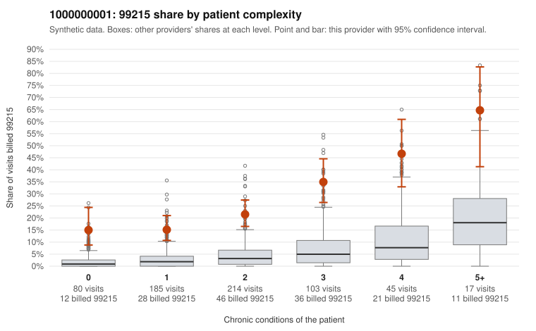

# 1000000001: Provider 1000000001's 99215 share is elevated in every complexity tier, including patients with no chronic conditions, but the few charts returned all support the billed level, so the pattern is unresolved.

**Leaning (advisory):** Inconclusive

## Why

1000000001 billed 99215 on 23.9% of 644 claims against an expected 3.3% given patient complexity (risk-adjusted score 10.97; plain z-score vs peers 3.68). 26% of this provider's 99215 claims were on patients with 0 or 1 chronic conditions. Records came back for 30 claims. Of 10 documented 99215 claims, 0 (0%) were documented below the billed level, against 9% for the comparison providers. 3 of 21 notes claiming moderate-or-higher data reviewed had no lab or test line on the claim. The excess is not concentrated among sicker patients. The 99215 share runs several times the all-provider rate in every complexity tier, including the 0- and 1-condition tiers. The sampled low-complexity 99215s include single-symptom or follow-up diagnoses such as C0000228 (Z09), C0000396 (R21) and C0000486 (R10.9), which is the pattern that would raise upcoding concern. On the other side, none of the 10 documented 99215 claims fell below the billed level, with examples like C0000113 and C0000332 showing high MDM. That is consistent with a legitimately complex panel, but it rests on under 5% of claims and may not include the low-complexity visits that matter most. The 3 notes claiming moderate-or-higher data review with no lab or test line on the claim are a weak hint of templated or inflated documentation, not proof. A reviewer should first request charts for the sampled 0- and 1-condition 99215 claims and check whether the notes are cloned across visits before relying on the favorable documentation result. Examples: C0000026: billed 99215, patient aged 39 with 1 chronic condition(s) (hypothyroidism). C0000055: billed 99215, patient aged 63 with 1 chronic condition(s) (hyperlipidemia).

## Evidence chart

## Cited claims

`C0000026`, `C0000055`

## Suggested next steps

- Request records for a larger sample of this provider's 99214 and 99215 claims; what came back is too thin to judge.
- Re-screen the provider once the records arrive.

---
Citations checked: 2/2 valid. Synthetic data. The leaning is advisory; the flag comes from the statistical screen, and no clinical documentation is available beyond the sampled records-review facts shown in the packet.
