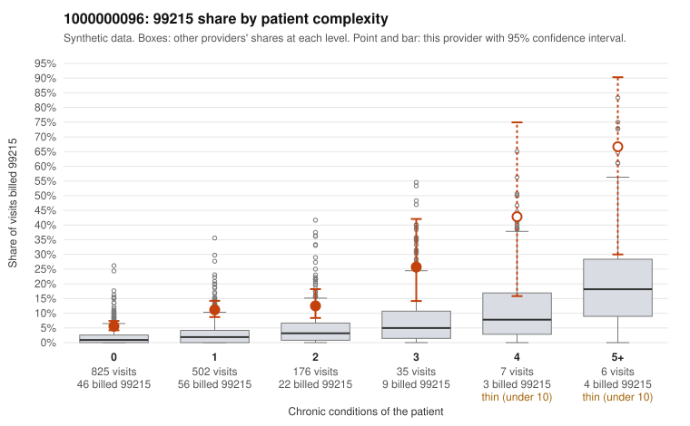

# 1000000096: Provider 1000000096's 99215 billing is concentrated on patients with few or no chronic conditions and runs above peer rates at every complexity level, a pattern consistent with upcoding, though the chart review is too thin to confirm it.

**Leaning (advisory):** Pattern consistent with upcoding

## Why

1000000096 billed 99215 on 9.0% of 1,551 claims against an expected 1.7% given patient complexity (risk-adjusted score 8.11; plain z-score vs peers 0.82). 73% of this provider's 99215 claims were on patients with 0 or 1 chronic conditions. Records came back for 30 claims. Of 3 documented 99215 claims, 0 (0%) were documented below the billed level, against 9% for the comparison providers. 2 of 19 notes claiming moderate-or-higher data reviewed had no lab or test line on the claim. The complexity comparison is the core concern. Most of this provider's 99215s fall on patients with 0–1 chronic conditions, and the sampled low-complexity 99215s (e.g., C0064844, C0065101, C0066128, C0066276) carry routine diagnoses such as UTI, follow-up, abdominal pain and URI, while the 99215 share exceeds the all-provider share in every complexity band, including patients with no conditions. The documentation neither confirms nor clears this: only 3 documented 99215s came back, all supported, which is too few to judge. One of them, C0065595, is a hypertension-plus-URI visit documented at high MDM, which deserves a close read for possible inflated or templated notes. The 2 notes claiming moderate-or-higher data reviewed with no lab or test line on the claim are weak evidence of note-to-service mismatch, not proof. Ambiguity remains because the plain peer z-score is unremarkable and the 99214-heavy mix could reflect a genuinely engaged practice style, so a reviewer should first request charts for a targeted sample of the low-complexity 99215s and check whether the MDM and time documented are specific to the visit or cloned. Examples: C0064844: billed 99215, patient aged 52 with 0 chronic condition(s). C0065061: billed 99215, patient aged 57 with 1 chronic condition(s) (hypertension). C0065099: billed 99215, patient aged 37 with 0 chronic condition(s).

## Evidence chart

## Cited claims

`C0064844`, `C0065061`, `C0065099`

## Suggested next steps

- Request the full records for the cited claims and have a certified coder re-score each against current E/M documentation rules (medical decision making or total time).
- If the re-scoring confirms the pattern, use the sampling plan in the recovery packet to review a statistical sample of this provider's 99215 claims.
- Check whether notes for the cited claims look copied forward, and whether documented minutes repeat from visit to visit.

---
Citations checked: 3/3 valid. Synthetic data. The leaning is advisory; the flag comes from the statistical screen, and no clinical documentation is available beyond the sampled records-review facts shown in the packet.
