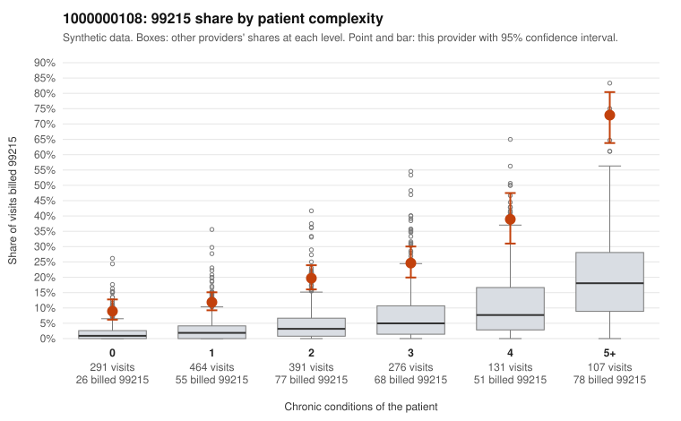

# 1000000108: Provider 1000000108 bills 99215 well above expectation in every complexity band, including simple acute visits, but the few charts returned all support the billed level, so the evidence points both ways.

**Leaning (advisory):** Inconclusive

## Why

1000000108 billed 99215 on 21.4% of 1,660 claims against an expected 3.7% given patient complexity (risk-adjusted score 14.42; plain z-score vs peers 3.19). 23% of this provider's 99215 claims were on patients with 0 or 1 chronic conditions. Records came back for 30 claims. Of 8 documented 99215 claims, 0 (0%) were documented below the billed level, against 9% for the comparison providers. 2 of 24 notes claiming moderate-or-higher data reviewed had no lab or test line on the claim. The elevated 99215 share holds across every complexity band, not just multi-morbid patients, and coding as a whole is shifted upward (99214 dominates the mix). So a sicker panel alone does not explain the pattern, and sampled 99215s for minor presentations such as rash (C0073392, C0074056), urinary infection (C0073136) and back pain (C0073472) are the clearest concern. Against that, none of the 8 documented 99215 claims was documented below the billed level, and all four sampled charts showed high MDM, including low-complexity claim C0074107 with 44 minutes. With records for under 2% of claims and only 8 documented 99215s, the documentation is too thin to clear the provider or to confirm upcoding. The 2 notes claiming moderate-or-higher data reviewed without a lab or test line on the claim are only a weak hint of templated or inflated notes. A reviewer should first request charts targeted at the 0–1 condition 99215 claims and check whether those notes show genuine high-complexity decision-making or cloned language. Examples: C0072987: billed 99213; documented MDM level straightforward, minutes not recorded. C0073270: billed 99214; documented MDM level low, minutes not recorded. C0072717: billed 99215, patient aged 37 with 1 chronic condition(s) (osteoarthritis). C0072750: billed 99215, patient aged 52 with 1 chronic condition(s) (depression).

## Evidence chart

## Cited claims

`C0072987`, `C0073270`, `C0072717`, `C0072750`

## Suggested next steps

- Request records for a larger sample of this provider's 99214 and 99215 claims; what came back is too thin to judge.
- Re-screen the provider once the records arrive.

---
Citations checked: 4/4 valid. Synthetic data. The leaning is advisory; the flag comes from the statistical screen, and no clinical documentation is available beyond the sampled records-review facts shown in the packet.
