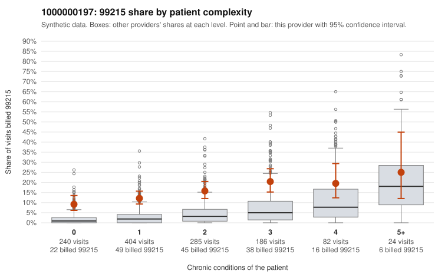

# 1000000197: Elevated 99215 billing is concentrated at every complexity tier, including low-complexity patients, but only three documented 99215 claims came back, too few to confirm or rule out upcoding.

**Leaning (advisory):** Inconclusive

## Why

1000000197 billed 99215 on 14.4% of 1,221 claims against an expected 3.0% given patient complexity (risk-adjusted score 8.72; plain z-score vs peers 1.86). 40% of this provider's 99215 claims were on patients with 0 or 1 chronic conditions. Records came back for 30 claims. Of 3 documented 99215 claims, 0 (0%) were documented below the billed level, against 9% for the comparison providers. 8 of 18 notes claiming moderate-or-higher data reviewed had no lab or test line on the claim. The billing pattern raises concern. The provider's 99215 share exceeds the all-provider share in every complexity band, and the gap is widest on patients with 0 or 1 conditions. The sampled low-complexity 99215 claims include visits coded only for routine follow-up (Z09, e.g., C0121562, C0121982), UTI (N39.0, e.g., C0121651) or rash (R21, e.g., C0121802), which rarely support high-complexity MDM. Against that, the 3 documented 99215 claims (C0121603, C0121687, C0122674) all showed high MDM, but three charts cannot outweigh the billing pattern, and the documentation is too thin to judge. The 8 notes claiming moderate-or-higher data review with no lab or test line on the claim are weak evidence that notes may be templated or inflated. A reviewer should first request records for the sampled low-complexity 99215 claims, starting with the Z09, N39.0 and R21 visits, and check those notes for cloned or templated language. Examples: C0121562: billed 99215, patient aged 73 with 0 chronic condition(s). C0121618: billed 99215, patient aged 48 with 1 chronic condition(s) (obesity).

## Evidence chart

## Cited claims

`C0121562`, `C0121618`

## Suggested next steps

- Request records for a larger sample of this provider's 99214 and 99215 claims; what came back is too thin to judge.
- Re-screen the provider once the records arrive.

---
Citations checked: 2/2 valid. Synthetic data. The leaning is advisory; the flag comes from the statistical screen, and no clinical documentation is available beyond the sampled records-review facts shown in the packet.
