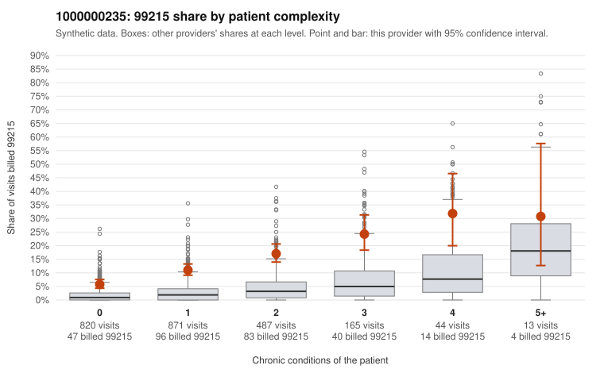

# 1000000235: Provider 1000000235 bills 99215 well above expected at every complexity level, with half of those visits on patients with 0–1 chronic conditions, but records came back for too few 99215 claims to confirm or rule out upcoding.

**Leaning (advisory):** Inconclusive

## Why

1000000235 billed 99215 on 11.8% of 2,400 claims against an expected 2.2% given patient complexity (risk-adjusted score 11.98; plain z-score vs peers 1.36). 50% of this provider's 99215 claims were on patients with 0 or 1 chronic conditions. Records came back for 30 claims. Of 6 documented 99215 claims, 1 (17%) were documented below the billed level, against 9% for the comparison providers. 4 of 21 notes claiming moderate-or-higher data reviewed had no lab or test line on the claim. The billing pattern leans toward concern. The 99215 share runs several times the all-provider rate even in the 0- and 1-condition strata. The low-complexity sample includes 99215s billed for routine-looking diagnoses such as follow-up (Z09), upper respiratory infection (J06.9) and nonspecific abdominal pain (R10.9), for example C0147963, C0148469 and C0149220. That is not what a legitimately sicker panel would explain. The documentation cuts the other way but is too thin to settle the question: only 6 documented 99215 claims came back. One was unsupported (C0148460, a J06.9 visit documented at moderate MDM), and four were supported at high MDM, so the unsupported rate sits between the rule's cutoffs and a single chart can swing it. The 4 notes claiming moderate-or-higher data reviewed with no lab or test line on the claim are weak evidence of templated or inflated notes, not proof. As a first step, a reviewer should request charts targeted at the low-complexity 99215 claims in the sample and check whether the MDM and any recorded time genuinely support level 5, watching for cloned note language. Examples: C0148460: billed 99215, patient aged 44 with 0 chronic condition(s); documented MDM level moderate, minutes not recorded. C0147748: billed 99215, patient aged 42 with 1 chronic condition(s) (obesity). C0147760: billed 99215, patient aged 57 with 0 chronic condition(s).

## Evidence chart

## Cited claims

`C0148460`, `C0147748`, `C0147760`

## Suggested next steps

- Request records for a larger sample of this provider's 99214 and 99215 claims; what came back is too thin to judge.
- Re-screen the provider once the records arrive.

---
Citations checked: 3/3 valid. Synthetic data. The leaning is advisory; the flag comes from the statistical screen, and no clinical documentation is available beyond the sampled records-review facts shown in the packet.
