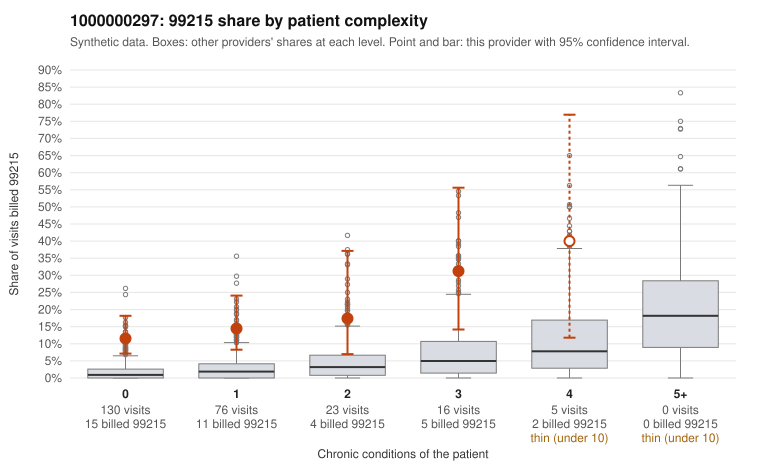

# 1000000297: Provider 1000000297's 99215 billing is concentrated on low-complexity patients, a pattern consistent with upcoding, but too few charts came back to confirm or refute it.

**Leaning (advisory):** Inconclusive

## Why

1000000297 billed 99215 on 14.8% of 250 claims against an expected 1.9% given patient complexity (risk-adjusted score 5.56; plain z-score vs peers 1.93). 70% of this provider's 99215 claims were on patients with 0 or 1 chronic conditions. Records came back for 30 claims. Of 3 documented 99215 claims, 0 (0%) were documented below the billed level, against 9% for the comparison providers. 3 of 21 notes claiming moderate-or-higher data reviewed had no lab or test line on the claim. The billing pattern is the main concern: 99215 use runs well above the all-provider share in every complexity stratum, including patients with no chronic conditions, and most sampled 99215s are for simple-looking problems such as URI (C0180230, C0180243), rash (C0180171, C0180194), and follow-up Z09 visits (C0180115, C0180140). That is not what a legitimately sicker panel would look like. The documentation does not settle it, because only 3 documented 99215 claims came back. All 3 support the billed level, which argues against upcoding but is far too thin a sample to rely on. One of those notes records high MDM for a zero-condition URI visit (C0180230), and a few notes claim moderate-or-higher data review with no lab or test on the claim; both are weak signs the notes may be inflated or templated, not proof. A reviewer should first request charts for more of the low-complexity 99215 claims listed here, especially the Z09, R21 and J06.9 visits, and check whether the high-MDM notes, starting with C0180230, show real problem complexity and data review or cloned template text. Examples: C0180144: billed 99213; documented MDM level straightforward, minutes not recorded. C0180282: billed 99214; documented MDM level low, minutes not recorded. C0180088: billed 99215, patient aged 51 with 1 chronic condition(s) (type 2 diabetes). C0180091: billed 99215, patient aged 68 with 1 chronic condition(s) (heart failure); documented MDM level high, minutes not recorded.

## Evidence chart

## Cited claims

`C0180144`, `C0180282`, `C0180088`, `C0180091`

## Suggested next steps

- Request records for a larger sample of this provider's 99214 and 99215 claims; what came back is too thin to judge.
- Re-screen the provider once the records arrive.

---
Citations checked: 4/4 valid. Synthetic data. The leaning is advisory; the flag comes from the statistical screen, and no clinical documentation is available beyond the sampled records-review facts shown in the packet.
