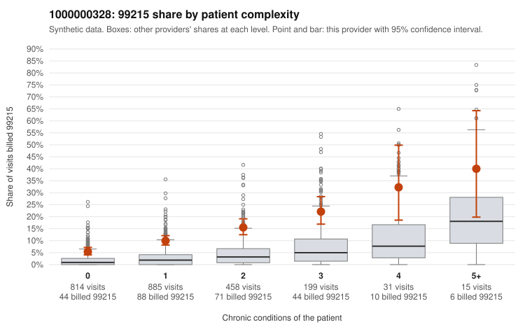

# 1000000328: Provider 1000000328 bills 99215 at roughly five times the complexity-adjusted expectation, with half of those claims on patients with few or no chronic conditions, but documentation is too thin to confirm or rule out upcoding.

**Leaning (advisory):** Inconclusive

## Why

1000000328 billed 99215 on 10.9% of 2,402 claims against an expected 2.2% given patient complexity (risk-adjusted score 10.84; plain z-score vs peers 1.19). 50% of this provider's 99215 claims were on patients with 0 or 1 chronic conditions. Records came back for 30 claims. Of 2 documented 99215 claims, 0 (0%) were documented below the billed level, against 9% for the comparison providers. 3 of 21 notes claiming moderate-or-higher data reviewed had no lab or test line on the claim. The billing pattern leans toward concern. The 99215 share runs well above the all-provider rate in every complexity band, including patients with zero conditions. Half of the 99215 claims fall on low-complexity patients, and the sampled examples show visits for diagnoses like Z09 follow-ups, R21 rash and J06.9 upper respiratory infection (e.g., C0196955, C0197943, C0198770), which would rarely need high-complexity decision-making. On the other side, the sampled high-complexity 99215 claims (e.g., C0196824, C0198894) look plausible, and the few charts returned show no documentation shortfalls. Both documented 99215 claims (C0199013, C0199154) supported a high level, but two charts cannot carry a judgment, and the small share of data-reviewed notes with no lab line on the claim is only weak evidence of inflated notes. A reviewer should first request charts specifically for low-complexity 99215 claims such as those listed above, to test whether high MDM is actually documented and whether notes appear templated or cloned. Examples: C0196793: billed 99215, patient aged 30 with 0 chronic condition(s). C0196955: billed 99215, patient aged 46 with 0 chronic condition(s).

## Evidence chart

## Cited claims

`C0196793`, `C0196955`

## Suggested next steps

- Request records for a larger sample of this provider's 99214 and 99215 claims; what came back is too thin to judge.
- Re-screen the provider once the records arrive.

---
Citations checked: 2/2 valid. Synthetic data. The leaning is advisory; the flag comes from the statistical screen, and no clinical documentation is available beyond the sampled records-review facts shown in the packet.
