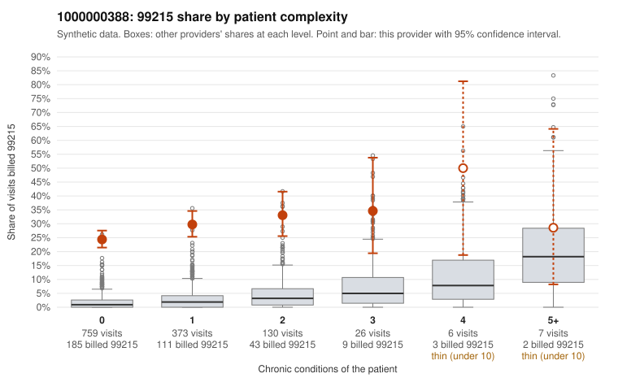

# 1000000388: 1000000388: 4 of 8 documented 99215 claims (50%) are documented below the billed level

**Leaning (advisory):** Pattern consistent with upcoding

## Why

1000000388 billed 99215 on 27.1% of 1,301 claims against an expected 1.7% given patient complexity (risk-adjusted score 26.46; plain z-score vs peers 4.29). 84% of this provider's 99215 claims were on patients with 0 or 1 chronic conditions. Records came back for 30 claims. Of 8 documented 99215 claims, 4 (50%) were documented below the billed level, against 9% for the comparison providers. 2 of 18 notes claiming moderate-or-higher data reviewed had no lab or test line on the claim. This pattern is consistent with upcoding. It is a reason to review the records, not a finding. Examples: C0224209: billed 99215; documented MDM level moderate, 35 minutes. C0224643: billed 99215; documented MDM level moderate, 25 minutes. C0224876: billed 99215; documented MDM level moderate, minutes not recorded. C0224228: billed 99215, patient aged 41 with 1 chronic condition(s) (heart failure). C0224288: billed 99215, patient aged 66 with 1 chronic condition(s) (atrial fibrillation). C0224318: billed 99215, patient aged 47 with 1 chronic condition(s) (asthma).

## Evidence chart

## Cited claims

`C0224209`, `C0224643`, `C0224876`, `C0224228`, `C0224288`, `C0224318`

## Suggested next steps

- Request the full records for the cited claims and have a certified coder re-score each against current E/M documentation rules (medical decision making or total time).
- If the re-scoring confirms the pattern, use the sampling plan in the recovery packet to review a statistical sample of this provider's 99215 claims.
- Check whether notes for the cited claims look copied forward, and whether documented minutes repeat from visit to visit.

---
Citations checked: 6/6 valid. Synthetic data. The leaning is advisory; the flag comes from the statistical screen, and no clinical documentation is available beyond the sampled records-review facts shown in the packet.
