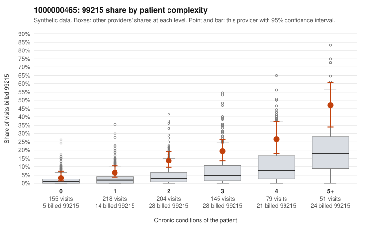

# 1000000465: Provider 1000000465 bills 99215 well above risk-adjusted expectation in every complexity tier, but the few charts returned support the billed levels, so documentation is too thin to call this upcoding.

**Leaning (advisory):** Inconclusive

## Why

1000000465 billed 99215 on 14.1% of 852 claims against an expected 3.7% given patient complexity (risk-adjusted score 5.98; plain z-score vs peers 1.79). 16% of this provider's 99215 claims were on patients with 0 or 1 chronic conditions. Records came back for 30 claims. Of 3 documented 99215 claims, 0 (0%) were documented below the billed level, against 9% for the comparison providers. 1 of 25 notes claiming moderate-or-higher data reviewed had no lab or test line on the claim. The by-complexity table shows this provider's 99215 share running roughly double the all-provider share in every condition-count tier, including 0–1 condition patients. A sicker panel alone does not explain that, and the billing is also heavily concentrated at 99214. Against that, every documented claim supported its billed level, including low-complexity 99215 claim C0261422 (one condition, documented high MDM, 32 minutes). Only 1 of 25 moderate-plus data-reviewed notes lacked a lab or test line, so there is little sign of cloned notes. Still, 3 documented 99215 claims cannot confirm or rule out a pattern, and records cover only a small share of claims. A reviewer should first request charts for the sampled low-complexity 99215 claims, such as C0261702, C0261846, C0261993 and C0261641/C0261829 (same patient, both hypertension visits), and for a sample of 99214 claims on 0–1 condition patients such as C0261405 and C0262088, then check whether MDM and time genuinely support the billed level. Examples: C0261422: billed 99215, patient aged 42 with 1 chronic condition(s) (hyperlipidemia); documented MDM level high, 32 minutes. C0261467: billed 99215, patient aged 53 with 1 chronic condition(s) (asthma).

## Evidence chart

## Cited claims

`C0261422`, `C0261467`

## Suggested next steps

- Request records for a larger sample of this provider's 99214 and 99215 claims; what came back is too thin to judge.
- Re-screen the provider once the records arrive.

---
Citations checked: 2/2 valid. Synthetic data. The leaning is advisory; the flag comes from the statistical screen, and no clinical documentation is available beyond the sampled records-review facts shown in the packet.
