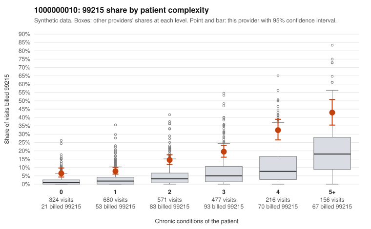

# 1000000010: Provider 1000000010 bills 99215 well above its risk-adjusted expectation at every complexity level, including low-complexity patients, but only two 99215 claims have documentation, too few to confirm or rule out upcoding.

**Leaning (advisory):** Inconclusive

## Why

1000000010 billed 99215 on 16.0% of 2,424 claims against an expected 3.9% given patient complexity (risk-adjusted score 11.65; plain z-score vs peers 2.15). 19% of this provider's 99215 claims were on patients with 0 or 1 chronic conditions. Records came back for 30 claims. Of 2 documented 99215 claims, 0 (0%) were documented below the billed level, against 9% for the comparison providers. Note checks on 30 returned notes (share showing each sign): problems 17%, late 7%, unsigned 0%, data 3%. No audit trail was received. 2 of 24 notes claiming moderate-or-higher data reviewed had no lab or test line on the claim. The billing pattern leans toward the concern. The elevated 99215 share holds within every complexity band, not only among sicker patients, and the sampled low-complexity 99215 claims carry simple diagnoses such as rash (R21), abdominal pain (R10.9) or follow-up (Z09) (e.g., C0003475, C0005250, C0005537). Against that, the provider's 99214 volume is also heavy, and the two documented 99215 claims (C0003750, C0003867) were supported at high MDM with about 48 to 49 minutes, so the documentation we have does not show inflation. With records for only about 1% of claims, and both 99214 mismatches (C0003446, C0005118) documented at low MDM with no time recorded, the documentation is too thin to judge, and the note signals (missing audit trail, a few repeated-time and no-lab data claims) are weak and nonspecific. A reviewer should first request charts targeted at the low-complexity 99215 claims listed in the packet, plus a larger 99214 sample, to see whether the documented MDM supports the billed level where patient complexity does not. Examples: C0003446: billed 99214; documented MDM level low, minutes not recorded. C0005118: billed 99214; documented MDM level low, minutes not recorded. C0003475: billed 99215, patient aged 48 with 0 chronic condition(s). C0003482: billed 99215, patient aged 44 with 1 chronic condition(s) (heart failure).

## Evidence chart

## Cited claims

`C0003446`, `C0005118`, `C0003475`, `C0003482`

## Suggested next steps

- 30 charts came back but do not settle it: request a targeted sample of 99215 charts, starting with C0003446, C0005118, C0003475.
- Re-check after the targeted charts arrive; do not call upcoding or a sicker panel on this evidence alone.

---
Citations checked: 4/4 valid. Synthetic data. The leaning is advisory; the flag comes from the statistical screen, and no clinical documentation is available beyond the sampled records-review facts shown in the packet.
