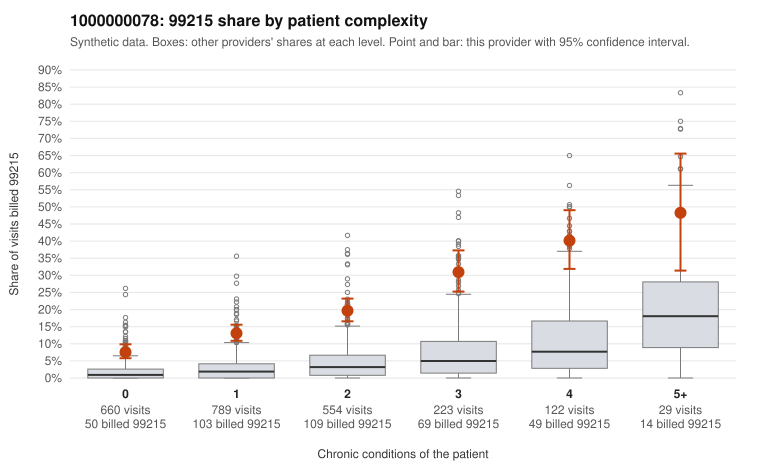

# 1000000078: 1000000078: too few returned records to judge

**Leaning (advisory):** Inconclusive

## Why

1000000078 billed 99215 on 16.6% of 2,377 claims against an expected 2.6% given patient complexity (risk-adjusted score 16.00; plain z-score vs peers 2.27). 39% of this provider's 99215 claims were on patients with 0 or 1 chronic conditions. Records came back for 21 claims. Of 16 documented 99215 claims, 0 (0%) were documented below the billed level, against 9% for the comparison providers. Note checks on 21 returned notes (share showing each sign): problems 29%, late 0%, unsigned 0%, data 5%. No audit trail was received. 2 of 17 notes claiming moderate-or-higher data reviewed had no lab or test line on the claim. The evidence does not support a call either way yet. Examples: C0053897: billed 99213; documented MDM level straightforward, minutes not recorded. C0051754: billed 99215, patient aged 78 with 0 chronic condition(s). C0051771: billed 99215, patient aged 42 with 1 chronic condition(s) (hypertension).

## Evidence chart

## Cited claims

`C0053897`, `C0051754`, `C0051771`

## Suggested next steps

- 21 charts came back but do not settle it: request a targeted sample of 99215 charts, starting with C0053897, C0051754, C0051771.
- Re-check after the targeted charts arrive; do not call upcoding or a sicker panel on this evidence alone.

---
Citations checked: 3/3 valid. Synthetic data. The leaning is advisory; the flag comes from the statistical screen, and no clinical documentation is available beyond the sampled records-review facts shown in the packet.
