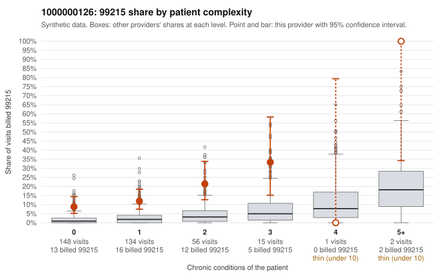

# 1000000126: 1000000126: 0 of 20 documented 99215 claims (0%) are documented below the billed level

**Leaning (advisory):** Pattern consistent with upcoding

## Why

1000000126 billed 99215 on 13.5% of 356 claims against an expected 1.9% given patient complexity (risk-adjusted score 5.82; plain z-score vs peers 1.68). 60% of this provider's 99215 claims were on patients with 0 or 1 chronic conditions. Records came back for 44 claims. Of 20 documented 99215 claims, 0 (0%) were documented below the billed level, against 9% for the comparison providers. Note checks on 44 returned notes (share showing each sign): problems 46%, late 14%, unsigned 0%, data 9%. No audit trail was received. 6 of 33 notes claiming moderate-or-higher data reviewed had no lab or test line on the claim. This pattern is consistent with upcoding. It is a reason to review the records, not a finding. Examples: C0082285: billed 99215, patient aged 39 with 0 chronic condition(s). C0082338: billed 99215, patient aged 67 with 1 chronic condition(s) (type 2 diabetes). C0082349: billed 99215, patient aged 70 with 1 chronic condition(s) (hyperlipidemia).

## Evidence chart

## Cited claims

`C0082285`, `C0082338`, `C0082349`

## Suggested next steps

- Request the full charts for C0082285, C0082338, C0082349 and have a certified coder re-score each against the current E/M rules (medical decision making or total time).
- If the re-scoring confirms the pattern, review the random sample in the recovery packet's sampling plan before any overpayment estimate; do not extrapolate from a targeted sample.
- Look at the notes themselves: 46% address fewer problems than their level implies and 14% were signed late; request the audit trail for C0082285, C0082338, C0082349.

---
Citations checked: 3/3 valid. Synthetic data. The leaning is advisory; the flag comes from the statistical screen, and no clinical documentation is available beyond the sampled records-review facts shown in the packet.
