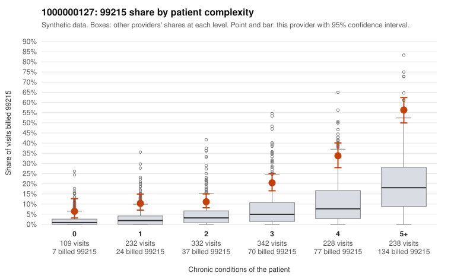

# 1000000127: Provider 1000000127 bills 99215 well above expectation in every complexity stratum, but the sampled 99215 notes support the billed level, so the pattern cannot yet be called upcoding or a sicker panel.

**Leaning (advisory):** Inconclusive

## Why

1000000127 billed 99215 on 23.6% of 1,481 claims against an expected 5.5% given patient complexity (risk-adjusted score 11.45; plain z-score vs peers 3.61). 9% of this provider's 99215 claims were on patients with 0 or 1 chronic conditions. Records came back for 45 claims. Of 20 documented 99215 claims, 0 (0%) were documented below the billed level, against 9% for the comparison providers. Note checks on 45 returned notes (share showing each sign): problems 0%, late 4%, unsigned 0%, data 7%. No audit trail was received. 6 of 36 notes claiming moderate-or-higher data reviewed had no lab or test line on the claim. The elevation is not confined to complex patients: the 99215 share runs roughly two to three times the all-provider share in every condition-count band, including 0–1 condition visits such as C0082671 (rash, no chronic conditions) and C0083885 (abdominal pain, age 24). That is a pattern consistent with a billing habit rather than a purely sicker panel. Against that, none of the 20 documented 99215 claims was documented below the billed level, and examples such as C0083285 and C0083453 show high MDM with plausible minutes, which is consistent with legitimately complex visits. The ambiguity is whether those notes reflect the encounters. Records cover only about 3% of claims, no audit trail was received, and there are weak template signals: repeated visit times and the 6 notes claiming moderate-or-higher data review with no lab or test line on the claim (e.g., C0082915, C0083816, C0084084). A reviewer should first request charts for the sampled low-complexity 99215 claims and the audit trail, then check whether the high-MDM 99215 notes are cloned or inflated. Examples: C0083403: billed 99214, patient aged 36 with 2 chronic condition(s) (type 2 diabetes;obesity); documented MDM level low, minutes not recorded. C0083591: billed 99214; documented MDM level low, 22 minutes. C0082661: billed 99215, patient aged 35 with 1 chronic condition(s) (hypothyroidism). C0082671: billed 99215, patient aged 48 with 0 chronic condition(s).

## Evidence chart

## Cited claims

`C0083403`, `C0083591`, `C0082661`, `C0082671`

## Suggested next steps

- 45 charts came back but do not settle it: request a targeted sample of 99215 charts, starting with C0083403, C0083591, C0082661.
- Re-check after the targeted charts arrive; do not call upcoding or a sicker panel on this evidence alone.

---
Citations checked: 4/4 valid. Synthetic data. The leaning is advisory; the flag comes from the statistical screen, and no clinical documentation is available beyond the sampled records-review facts shown in the packet.
