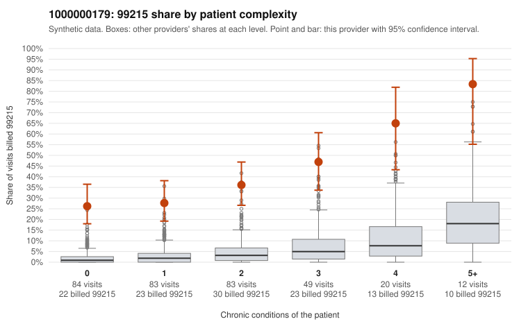

# 1000000179: Provider 1000000179 bills 99215 far above expectation in every complexity stratum, including routine single-problem visits, but the small documentation sample neither confirms nor clearly refutes upcoding.

**Leaning (advisory):** Inconclusive

## Why

1000000179 billed 99215 on 36.6% of 331 claims against an expected 3.1% given patient complexity (risk-adjusted score 13.07; plain z-score vs peers 6.10). 37% of this provider's 99215 claims were on patients with 0 or 1 chronic conditions. Records came back for 28 claims. Of 8 documented 99215 claims, 1 (12%) were documented below the billed level, against 9% for the comparison providers. Note checks on 28 returned notes (share showing each sign): problems 32%, late 0%, unsigned 0%, data 7%. No audit trail was received. 3 of 23 notes claiming moderate-or-higher data reviewed had no lab or test line on the claim. The claims pattern does not look like a sicker panel: the excess 99215 share appears in every complexity stratum, not just among multi-morbid patients. Many sampled low-complexity 99215s carry routine diagnoses such as urinary infection, upper respiratory infection or back pain (e.g., C0112738, C0112795, C0112853, C0112932), which is the pattern consistent with upcoding. The documentation points the other way but is too thin to settle the question. Only 8 documented 99215 claims came back, and their unsupported rate is close to the comparison rate; supported high-MDM examples such as C0112740 and C0112748 exist. One unsupported claim, C0112769, is itself a low-complexity urinary-infection visit. The note signals are ambiguous: about a third of notes flag problems, no audit trail was received to test for cloned or bulk-created notes, and the few moderate-plus data-reviewed notes without a lab line are only weak evidence of inflated documentation. A reviewer should first request charts specifically for the low-complexity 99215 claims listed (starting with C0112728, C0112795, C0112873 and C0112932), plus the EHR audit trail, to see whether those notes genuinely support high MDM or 40+ minutes. Examples: C0112769: billed 99215, patient aged 31 with 0 chronic condition(s); documented MDM level moderate, minutes not recorded. C0112698: billed 99215, patient aged 21 with 1 chronic condition(s) (atrial fibrillation). C0112728: billed 99215, patient aged 30 with 0 chronic condition(s).

## Evidence chart

## Cited claims

`C0112769`, `C0112698`, `C0112728`

## Suggested next steps

- 28 charts came back but do not settle it: request a targeted sample of 99215 charts, starting with C0112769, C0112698, C0112728.
- Re-check after the targeted charts arrive; do not call upcoding or a sicker panel on this evidence alone.

---
Citations checked: 3/3 valid. Synthetic data. The leaning is advisory; the flag comes from the statistical screen, and no clinical documentation is available beyond the sampled records-review facts shown in the packet.
