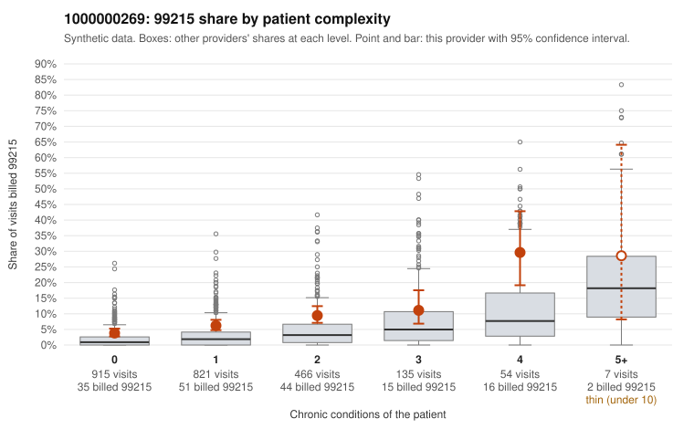

# 1000000269: Provider 1000000269 bills 99215 well above its risk-adjusted expectation, including on many low-complexity patients, yet every returned 99215 chart supports the billed level, so the evidence points both ways.

**Leaning (advisory):** Inconclusive

## Why

1000000269 billed 99215 on 6.8% of 2,398 claims against an expected 2.1% given patient complexity (risk-adjusted score 5.88; plain z-score vs peers 0.40). 53% of this provider's 99215 claims were on patients with 0 or 1 chronic conditions. Records came back for 45 claims. Of 18 documented 99215 claims, 0 (0%) were documented below the billed level, against 9% for the comparison providers. Note checks on 45 returned notes (share showing each sign): problems 27%, late 7%, unsigned 0%, data 2%. No audit trail was received. 1 of 29 notes claiming moderate-or-higher data reviewed had no lab or test line on the claim. The claim side leans toward upcoding: the 99215 excess appears at every complexity level, and the low-complexity sample includes 99215s for brief, single-issue diagnoses such as URI (C0167013), unspecified abdominal pain (C0166953, C0167109) and UTI (C0167215), which rarely need high-complexity decision-making. The documentation side points the other way: none of the 18 returned 99215 charts fell below the billed level, against the comparison providers' rate. Only one note claiming moderate-or-higher data review lacked a lab or test line, so there is little sign of inflated data entries. The ambiguity is that records cover only a small sample of claims, and the packet does not show whether the documented 99215s came from complex or low-complexity patients, so the supported charts may not represent the concerning claims. The problems flag on about a quarter of notes, the repeated-time pattern, and the missing audit trail also mean cloned or templated notes cannot be ruled out. A reviewer should first request charts for the sampled low-complexity 99215 claims and check whether their MDM genuinely reaches high. Next, they should look at the problems-flagged notes (e.g., C0166953, C0166715) and obtain the EHR audit trail to test for templated documentation. Examples: C0167022: billed 99214; documented MDM level low, minutes not recorded. C0166604: billed 99215, patient aged 49 with 0 chronic condition(s). C0166670: billed 99215, patient aged 35 with 1 chronic condition(s) (COPD).

## Evidence chart

## Cited claims

`C0167022`, `C0166604`, `C0166670`

## Suggested next steps

- 45 charts came back but do not settle it: request a targeted sample of 99215 charts, starting with C0167022, C0166604, C0166670.
- Re-check after the targeted charts arrive; do not call upcoding or a sicker panel on this evidence alone.

---
Citations checked: 3/3 valid. Synthetic data. The leaning is advisory; the flag comes from the statistical screen, and no clinical documentation is available beyond the sampled records-review facts shown in the packet.
