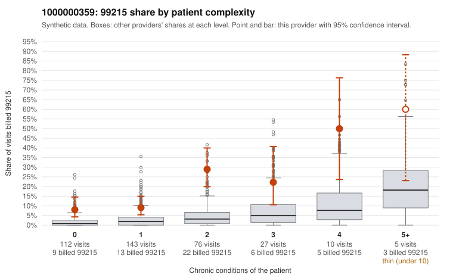

# 1000000359: Provider 1000000359 bills 99215 far above the expected rate in every complexity stratum, including healthy patients, yet every documented 99215 in the records sample supports the billed level, so the evidence conflicts.

**Leaning (advisory):** Inconclusive

## Why

1000000359 billed 99215 on 15.6% of 373 claims against an expected 2.4% given patient complexity (risk-adjusted score 6.18; plain z-score vs peers 2.07). 38% of this provider's 99215 claims were on patients with 0 or 1 chronic conditions. Records came back for 45 claims. Of 19 documented 99215 claims, 0 (0%) were documented below the billed level, against 9% for the comparison providers. Note checks on 45 returned notes (share showing each sign): problems 31%, late 9%, unsigned 0%, data 4%. No audit trail was received. 3 of 34 notes claiming moderate-or-higher data reviewed had no lab or test line on the claim. The billing pattern on its own fits upcoding. The 99215 share is elevated even among patients with 0 or 1 chronic conditions, and the sampled low-complexity 99215s include routine presentations such as upper respiratory infection (C0211592, C0211645) and urinary tract infection (C0211664, C0211823). Against that, none of the documented 99215 claims fell below the billed level, and the 18-year-old CKD visit C0211712 was documented at high MDM, which points toward a sicker or more complex panel than diagnosis counts capture. The documentation is not clean proof, though: records cover only a small share of claims, minutes are often not recorded, about one in eight notes show repeated time, and no audit trail was received to rule out templated or cloned notes. The few notes claiming moderate-plus data review with no lab or test on the claim (for example C0211682) are weak evidence that some notes overstate the work done. A reviewer should first pull full charts for the low-complexity 99215 claims, starting with the URI, UTI and back-pain visits, and request the EHR audit trail to check whether note content is copied forward or generated to match the billed level. Examples: C0211472: billed 99215, patient aged 38 with 1 chronic condition(s) (type 2 diabetes). C0211502: billed 99215, patient aged 38 with 1 chronic condition(s) (heart failure).

## Evidence chart

## Cited claims

`C0211472`, `C0211502`

## Suggested next steps

- 45 charts came back but do not settle it: request a targeted sample of 99215 charts, starting with C0211472, C0211502.
- Re-check after the targeted charts arrive; do not call upcoding or a sicker panel on this evidence alone.

---
Citations checked: 2/2 valid. Synthetic data. The leaning is advisory; the flag comes from the statistical screen, and no clinical documentation is available beyond the sampled records-review facts shown in the packet.
