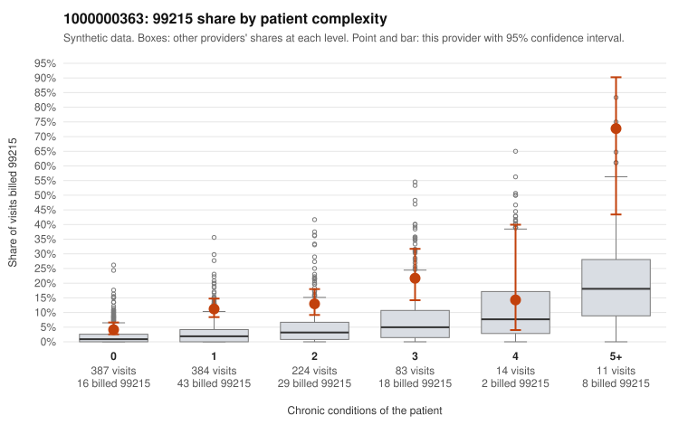

# 1000000363: Provider 1000000363's 99215 claims cluster heavily on low-complexity patients, but every documented 99215 note supports the billed level, so claims and charts point in opposite directions.

**Leaning (advisory):** Inconclusive

## Why

1000000363 billed 99215 on 10.5% of 1,103 claims against an expected 2.2% given patient complexity (risk-adjusted score 6.88; plain z-score vs peers 1.11). 51% of this provider's 99215 claims were on patients with 0 or 1 chronic conditions. Records came back for 45 claims. Of 16 documented 99215 claims, 0 (0%) were documented below the billed level, against 9% for the comparison providers. Note checks on 45 returned notes (share showing each sign): problems 33%, late 9%, unsigned 0%, data 4%. No audit trail was received. 2 of 29 notes claiming moderate-or-higher data reviewed had no lab or test line on the claim. The claims pattern is consistent with upcoding. The 99215 share runs above the all-provider rate in every complexity band, including 0- and 1-condition patients, and the sampled low-complexity 99215s include routine presentations such as upper respiratory infection (J06.9), low back pain and abdominal pain (e.g., C0212917, C0212922, C0213409). The 99214-dominant mix fits the same picture. Against that, none of the 16 documented 99215 claims fell below the billed level, which on its face supports the billing. Two of the supported examples are concerning, though: C0213237 and C0213620 are J06.9 visits on patients with no chronic conditions that were documented at high MDM. That raises the possibility of templated or inflated notes rather than truly complex encounters. Supporting this, a third of returned notes flagged problem-list issues, about one in eight showed repeated times, and no audit trail was received, although the no-lab mismatch on data reviewed is minor. Records cover only about 4% of claims, so a reviewer should first pull full charts for the low-complexity 99215 claims in the packet, compare the high-MDM notes for C0213237 and C0213620 against the actual visit content, and obtain the EHR audit trail to check for cloned or bulk-created documentation. Examples: C0212816: billed 99213; documented MDM level straightforward, minutes not recorded. C0213724: billed 99214; documented MDM level low, minutes not recorded. C0212756: billed 99215, patient aged 48 with 1 chronic condition(s) (osteoarthritis). C0212854: billed 99215, patient aged 51 with 1 chronic condition(s) (hyperlipidemia).

## Evidence chart

## Cited claims

`C0212816`, `C0213724`, `C0212756`, `C0212854`

## Suggested next steps

- 45 charts came back but do not settle it: request a targeted sample of 99215 charts, starting with C0212816, C0213724, C0212756.
- Re-check after the targeted charts arrive; do not call upcoding or a sicker panel on this evidence alone.

---
Citations checked: 4/4 valid. Synthetic data. The leaning is advisory; the flag comes from the statistical screen, and no clinical documentation is available beyond the sampled records-review facts shown in the packet.
