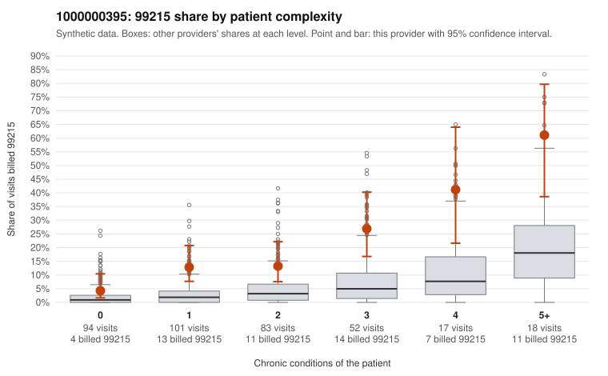

# 1000000395: Provider 1000000395 bills 99215 at roughly five times the complexity-adjusted expectation, and returned charts support the billed levels, but heavy note duplication leaves open whether that documentation reflects the visits.

**Leaning (advisory):** Inconclusive

## Why

1000000395 billed 99215 on 16.4% of 365 claims against an expected 3.2% given patient complexity (risk-adjusted score 5.36; plain z-score vs peers 2.24). 28% of this provider's 99215 claims were on patients with 0 or 1 chronic conditions. Records came back for 44 claims. Of 17 documented 99215 claims, 0 (0%) were documented below the billed level, against 9% for the comparison providers. Note checks on 44 returned notes (share showing each sign): problems 30%, late 7%, unsigned 0%, data 4%. No audit trail was received. 3 of 27 notes claiming moderate-or-higher data reviewed had no lab or test line on the claim. The 99215 share runs above the all-provider rate in every complexity band, including patients with no chronic conditions (e.g., C0230342, C0230479 and C0230617, billed with only Z09 follow-up codes). That points to a practice-wide billing habit rather than a sicker panel alone, even though the share rises appropriately with complexity. Against this, none of the documented 99215 claims fell below the billed level, including low-complexity C0230331, recorded at high MDM and 54 minutes, which is consistent with legitimate complexity. However, about 43% of returned notes were flagged as duplicates and 13% for repeated times, and no audit trail was received, so the supporting notes could be templated or cloned rather than independent evidence. A reviewer should first obtain the EHR audit trail and compare the flagged duplicate notes for cloned text. Next, pull full charts for the zero- and one-condition 99215 claims, starting with C0230255, which also carries a problems flag, to test whether the high MDM is clinically credible. Examples: C0230312: billed 99214; documented MDM level low, 28 minutes. C0230610: billed 99214; documented MDM level low, minutes not recorded. C0230227: billed 99215, patient aged 78 with 1 chronic condition(s) (COPD). C0230237: billed 99215, patient aged 78 with 1 chronic condition(s) (COPD).

## Evidence chart

## Cited claims

`C0230312`, `C0230610`, `C0230227`, `C0230237`

## Suggested next steps

- 44 charts came back but do not settle it: request a targeted sample of 99215 charts, starting with C0230312, C0230610, C0230227.
- Re-check after the targeted charts arrive; do not call upcoding or a sicker panel on this evidence alone.

---
Citations checked: 4/4 valid. Synthetic data. The leaning is advisory; the flag comes from the statistical screen, and no clinical documentation is available beyond the sampled records-review facts shown in the packet.
