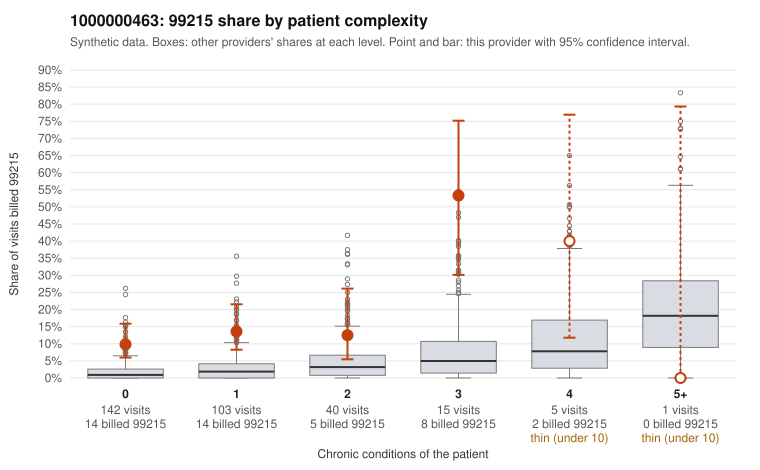

# 1000000463: Provider 1000000463 bills 99215 far above expectation, mostly on low-complexity patients. Every returned chart supports the billed level, but note-quality signals raise questions about whether that documentation reflects the visits.

**Leaning (advisory):** Inconclusive

## Why

1000000463 billed 99215 on 14.1% of 306 claims against an expected 1.9% given patient complexity (risk-adjusted score 5.68; plain z-score vs peers 1.79). 65% of this provider's 99215 claims were on patients with 0 or 1 chronic conditions. Records came back for 45 claims. Of 19 documented 99215 claims, 0 (0%) were documented below the billed level, against 9% for the comparison providers. Note checks on 45 returned notes (share showing each sign): problems 40%, late 18%, unsigned 0%, data 20%. No audit trail was received. 9 of 34 notes claiming moderate-or-higher data reviewed had no lab or test line on the claim. The billing pattern points toward upcoding: the 99215 excess sits mainly in the 0–1 condition groups. The sampled low-complexity 99215s are routine-sounding diagnoses such as Z09 follow-ups, R21 rash, J06.9 URI and M54.50 back pain (e.g., C0260904, C0261123, C0261150). The documentation, however, does not show unsupported billing: none of the documented 99215s fell below the billed level, and supported examples such as C0260989 (back pain) and C0261036 (abdominal pain) record high MDM. That could fit legitimately complex acute workups, but a zero mismatch rate below the noise seen in honest providers is unusual. Combined with the duplicate-note rate, problem-list flags and data-reviewed claims lacking any lab or test line, it is weak evidence that notes may be templated or inflated rather than proof that the visits were complex. C0260989 is also among the late-note examples. A reviewer should first request the audit trail (not received) to check creation and edit timing and cloning. Next, compare the actual note text of the high-MDM low-complexity 99215s (C0260989, C0261036, C0260889, C0260904, C0260925) for repeated language and for data elements that the claims do not corroborate. Examples: C0260871: billed 99215, patient aged 67 with 1 chronic condition(s) (asthma). C0260889: billed 99215, patient aged 61 with 1 chronic condition(s) (obesity).

## Evidence chart

## Cited claims

`C0260871`, `C0260889`

## Suggested next steps

- 45 charts came back but do not settle it: request a targeted sample of 99215 charts, starting with C0260871, C0260889.
- Re-check after the targeted charts arrive; do not call upcoding or a sicker panel on this evidence alone.

---
Citations checked: 2/2 valid. Synthetic data. The leaning is advisory; the flag comes from the statistical screen, and no clinical documentation is available beyond the sampled records-review facts shown in the packet.
