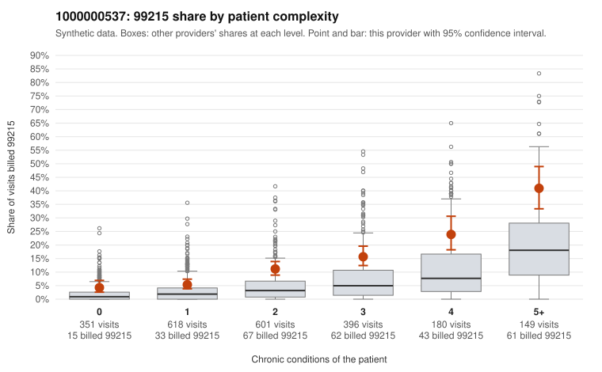

# 1000000537: Provider 1000000537 bills 99215 at roughly double the all-provider rate in every complexity stratum; the few returned charts support the billed levels but are too thin to settle the question.

**Leaning (advisory):** Inconclusive

## Why

1000000537 billed 99215 on 12.2% of 2,295 claims against an expected 3.8% given patient complexity (risk-adjusted score 8.02; plain z-score vs peers 1.44). 17% of this provider's 99215 claims were on patients with 0 or 1 chronic conditions. Records came back for 30 claims. Of 6 documented 99215 claims, 0 (0%) were documented below the billed level, against 9% for the comparison providers. Note checks on 30 returned notes (share showing each sign): problems 10%, late 0%, unsigned 0%, data 7%. No audit trail was received. 2 of 19 notes claiming moderate-or-higher data reviewed had no lab or test line on the claim. The by-complexity table shows about twice the all-provider 99215 share at every condition count, including 0 and 1 conditions. Because the excess persists after holding complexity fixed, a sicker panel does not explain it, and the pattern is consistent with a provider-level coding habit. Against that, none of the 6 documented 99215 claims fell below the billed level. That sample is far too small to clear the provider, and the documentation has warning signs of its own. Supported claim C0296764 is a 99215 for a patient with no chronic conditions and an upper respiratory infection (J06.9), documented as high MDM with no time recorded, and the same note is flagged for a problems signal. The returned notes also show some repeated time entries, two notes claim moderate-or-higher data reviewed with no lab or test line on the claim, and no audit trail was received to rule out cloned or templated notes. A reviewer should first pull charts for the sampled low-complexity 99215 claims (for example C0296805, C0297696, C0298054, C0298917), check whether high MDM is credible for simple diagnoses like back pain and abdominal pain, and request the EHR audit trail to test for templated documentation. Examples: C0296764: billed 99215, patient aged 67 with 0 chronic condition(s); documented MDM level high, minutes not recorded. C0296805: billed 99215, patient aged 47 with 0 chronic condition(s).

## Evidence chart

## Cited claims

`C0296764`, `C0296805`

## Suggested next steps

- 30 charts came back but do not settle it: request a targeted sample of 99215 charts, starting with C0296764, C0296805.
- Re-check after the targeted charts arrive; do not call upcoding or a sicker panel on this evidence alone.

---
Citations checked: 2/2 valid. Synthetic data. The leaning is advisory; the flag comes from the statistical screen, and no clinical documentation is available beyond the sampled records-review facts shown in the packet.
