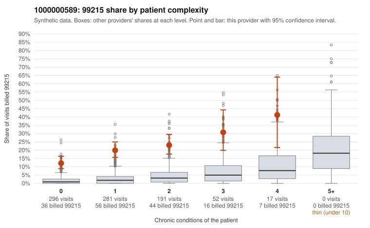

# 1000000589: 1000000589: 5 of 12 documented 99214 and 99215 claims (42%) are documented below the billed level

**Leaning (advisory):** Pattern consistent with upcoding

## Why

1000000589 billed 99215 on 19.0% of 837 claims against an expected 2.1% given patient complexity (risk-adjusted score 12.51; plain z-score vs peers 2.73). 58% of this provider's 99215 claims were on patients with 0 or 1 chronic conditions. Records came back for 17 claims. Of 4 documented 99215 claims, 2 (50%) were documented below the billed level, against 9% for the comparison providers. Note checks on 17 returned notes (share showing each sign): problems 24%, late 6%, unsigned 0%, data 0%. No audit trail was received. 0 of 11 notes claiming moderate-or-higher data reviewed had no lab or test line on the claim. This pattern is consistent with upcoding. It is a reason to review the records, not a finding. Examples: C0326409: billed 99215; documented MDM level moderate, minutes not recorded. C0326941: billed 99215; documented MDM level moderate, 35 minutes. C0326287: billed 99215, patient aged 51 with 1 chronic condition(s) (asthma). C0326325: billed 99215, patient aged 38 with 0 chronic condition(s). C0326346: billed 99215, patient aged 44 with 1 chronic condition(s) (depression).

## Evidence chart

## Cited claims

`C0326409`, `C0326941`, `C0326287`, `C0326325`, `C0326346`

## Suggested next steps

- Request the full charts for C0326409, C0326941, C0326287 and have a certified coder re-score each against the current E/M rules (medical decision making or total time).
- If the re-scoring confirms the pattern, review the random sample in the recovery packet's sampling plan before any overpayment estimate; do not extrapolate from a targeted sample.
- Look at the notes themselves: 24% address fewer problems than their level implies and 6% were signed late; request the audit trail for C0326409, C0326941, C0326287.

---
Citations checked: 5/5 valid. Synthetic data. The leaning is advisory; the flag comes from the statistical screen, and no clinical documentation is available beyond the sampled records-review facts shown in the packet.
