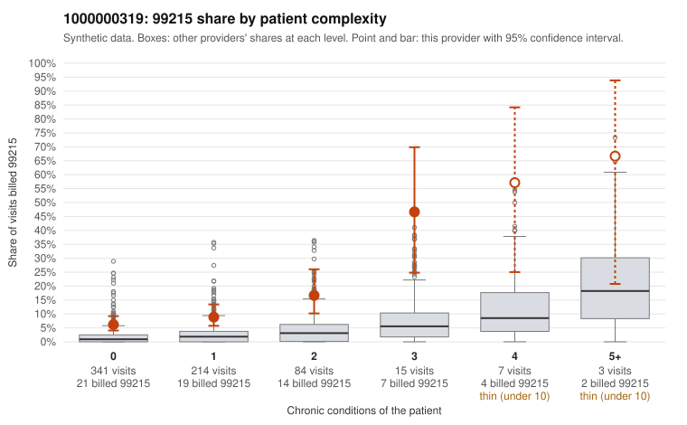

# 1000000319: Provider 1000000319 bills 99215 well above its risk-adjusted expectation, mostly on patients with few or no chronic conditions, but the records sample is too thin to confirm or refute support.

**Leaning (advisory):** Pattern consistent with upcoding

## Why

1000000319 billed 99215 on 10.1% of 664 claims against an expected 1.8% given patient complexity (risk-adjusted score 6.30; plain z-score vs peers 1.03). 60% of this provider's 99215 claims were on patients with 0 or 1 chronic conditions. Records came back for 30 claims. Of 1 documented 99215 claims, 0 (0%) were documented below the billed level, against 9% for the comparison providers. 1 of 19 notes claiming moderate-or-higher data reviewed had no lab or test line on the claim. The 99215 share runs several times the all-provider rate in every complexity band, and most 99215s fall on patients with 0 or 1 chronic conditions. That is not what a sicker panel looks like. The sampled low-complexity 99215s are often for minimal-complexity diagnoses: follow-up encounters (Z09, e.g. C0178035, C0178040), rash (R21, e.g. C0178123, C0178249), back pain (C0178017) and upper respiratory infection (C0178433). Documentation cannot settle the question. Only one documented 99215 came back. It was supported (C0178372), though it is a high-MDM, 47-minute rash visit for an 18-year-old with no chronic conditions, which is worth a closer look. The data-reviewed versus lab-line check shows almost no signal. Two points are ambiguous: the heavy 99214 volume may reflect a generally high-intensity practice style, and the modest plain peer z-score suggests some peers bill similarly. The reviewer should first request charts for the low-complexity 99215 claims listed, especially the Z09 and R21 visits. Enough documented 99215s are needed to compare the unsupported rate against the comparison providers' 9%. Examples: C0177813: billed 99215, patient aged 53 with 1 chronic condition(s) (atrial fibrillation). C0177845: billed 99215, patient aged 31 with 1 chronic condition(s) (asthma). C0177858: billed 99215, patient aged 18 with 0 chronic condition(s).

## Evidence chart

## Cited claims

`C0177813`, `C0177845`, `C0177858`

## Suggested next steps

- Request the full records for the cited claims and have a certified coder re-score each against current E/M documentation rules (medical decision making or total time).
- If the re-scoring confirms the pattern, use the sampling plan in the recovery packet to review a statistical sample of this provider's 99215 claims.
- Check whether notes for the cited claims look copied forward, and whether documented minutes repeat from visit to visit.

---
Citations checked: 3/3 valid. Synthetic data. The leaning is advisory; the flag comes from the statistical screen, and no clinical documentation is available beyond the sampled records-review facts shown in the packet.
