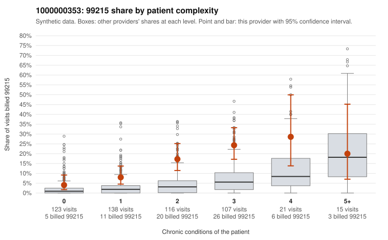

# 1000000353: Provider 1000000353 bills 99215 at well above the risk-adjusted expectation in every complexity tier, but the few returned charts support the billed levels, so the documentation is too thin to settle upcoding versus a complex panel.

**Leaning (advisory):** Inconclusive

## Why

1000000353 billed 99215 on 13.7% of 520 claims against an expected 3.1% given patient complexity (risk-adjusted score 5.44; plain z-score vs peers 1.70). 23% of this provider's 99215 claims were on patients with 0 or 1 chronic conditions. Records came back for 30 claims. Of 5 documented 99215 claims, 0 (0%) were documented below the billed level, against 9% for the comparison providers. 0 of 18 notes claiming moderate-or-higher data reviewed had no lab or test line on the claim. The claims data lean toward concern: the 99215 share sits above the all-provider share in nearly every complexity tier, including patients with 0 to 1 conditions. Sampled low-complexity 99215s such as C0201456 (N39.0 only), C0201474 and C0201992 (J06.9 only) carry minor acute diagnoses that would not usually support high-complexity decision-making. Against that, the records review found no unsupported 99215s, and sampled charts such as C0201820 and C0201601 document high MDM. The data-reviewed claims also line up with lab or test lines, so there is no sign of cloned notes. However, only 5 documented 99215s came back from a small overall return, which is too few to confirm or rule out upcoding, and the multi-morbid 99215s (for example C0201518 and C0201509) look clinically plausible. A reviewer should first request charts specifically for the low-complexity 99215 claims listed, starting with C0201456, C0201474, C0201677 and C0201992. Those claims should be checked for documented MDM or time that justifies level 5. Examples: C0201909: billed 99214; documented MDM level low, minutes not recorded. C0201454: billed 99215, patient aged 49 with 1 chronic condition(s) (hyperlipidemia). C0201456: billed 99215, patient aged 59 with 0 chronic condition(s).

## Evidence chart

## Cited claims

`C0201909`, `C0201454`, `C0201456`

## Suggested next steps

- Request records for a larger sample of this provider's 99214 and 99215 claims; what came back is too thin to judge.
- Re-screen the provider once the records arrive.

---
Citations checked: 3/3 valid. Synthetic data. The leaning is advisory; the flag comes from the statistical screen, and no clinical documentation is available beyond the sampled records-review facts shown in the packet.
