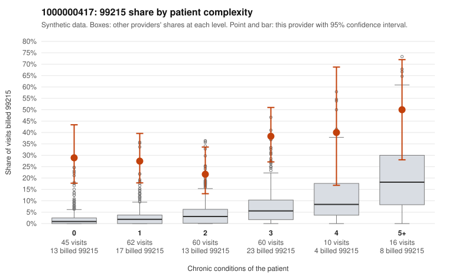

# 1000000417: 1000000417: too few returned records to judge

**Leaning (advisory):** Inconclusive

## Why

1000000417 billed 99215 on 30.8% of 253 claims against an expected 3.7% given patient complexity (risk-adjusted score 9.06; plain z-score vs peers 4.91). 38% of this provider's 99215 claims were on patients with 0 or 1 chronic conditions. Records came back for 0 claims. No documented 99215 claims came back. The evidence does not support a call either way yet. Examples: C0231795: billed 99215, patient aged 45 with 0 chronic condition(s). C0231813: billed 99215, patient aged 53 with 1 chronic condition(s) (type 2 diabetes).

## Evidence chart

## Cited claims

`C0231795`, `C0231813`

## Suggested next steps

- Request records for a larger sample of this provider's 99214 and 99215 claims; what came back is too thin to judge.
- Re-screen the provider once the records arrive.

---
Citations checked: 2/2 valid. Synthetic data. The leaning is advisory; the flag comes from the statistical screen, and no clinical documentation is available beyond the sampled records-review facts shown in the packet.
