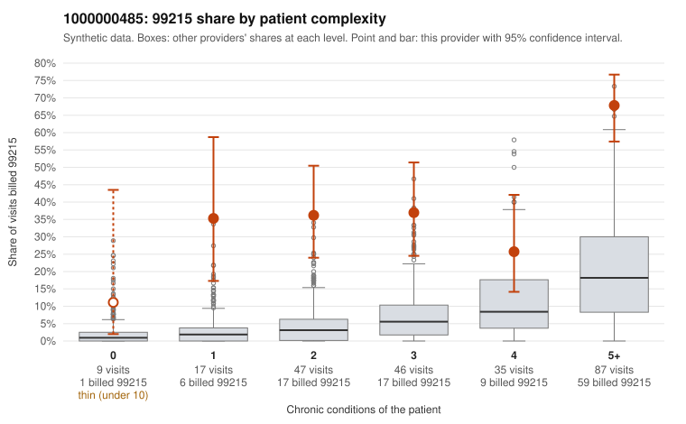

# 1000000485: 1000000485: too few returned records to judge

**Leaning (advisory):** Inconclusive

## Why

1000000485 billed 99215 on 45.2% of 241 claims against an expected 8.1% given patient complexity (risk-adjusted score 8.36; plain z-score vs peers 7.59). 6% of this provider's 99215 claims were on patients with 0 or 1 chronic conditions. Records came back for 3 claims. Of 1 documented 99215 claims, 1 (100%) were documented below the billed level, against 9% for the comparison providers. 0 of 1 notes claiming moderate-or-higher data reviewed had no lab or test line on the claim. The evidence does not support a call either way yet. Examples: C0261075: billed 99215; documented MDM level moderate, minutes not recorded. C0260952: billed 99215, patient aged 64 with 1 chronic condition(s) (type 2 diabetes). C0260966: billed 99215, patient aged 50 with 0 chronic condition(s).

## Evidence chart

## Cited claims

`C0261075`, `C0260952`, `C0260966`

## Suggested next steps

- Request records for a larger sample of this provider's 99214 and 99215 claims; what came back is too thin to judge.
- Re-screen the provider once the records arrive.

---
Citations checked: 3/3 valid. Synthetic data. The leaning is advisory; the flag comes from the statistical screen, and no clinical documentation is available beyond the sampled records-review facts shown in the packet.
