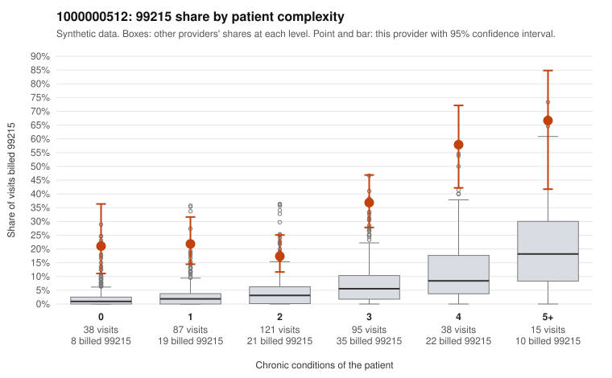

# 1000000512: Provider 1000000512's 99215 rate is elevated in every complexity tier, including patients with 0 or 1 conditions, but the five documented 99215 charts all support the billed level and are too few to settle the question.

**Leaning (advisory):** Inconclusive

## Why

1000000512 billed 99215 on 29.2% of 394 claims against an expected 3.8% given patient complexity (risk-adjusted score 10.37; plain z-score vs peers 4.60). 23% of this provider's 99215 claims were on patients with 0 or 1 chronic conditions. Records came back for 18 claims. Of 5 documented 99215 claims, 0 (0%) were documented below the billed level, against 9% for the comparison providers. 1 of 14 notes claiming moderate-or-higher data reviewed had no lab or test line on the claim. A sicker panel does not explain the claims pattern well. The 99215 share runs far above the all-provider share in every condition stratum, including patients with no chronic conditions, and the sampled low-complexity 99215s carry routine diagnoses such as unspecified abdominal pain (C0275208), upper respiratory infection (C0275392) and uncomplicated hypertension (C0275350, C0275370). The documentation does not confirm upcoding, though. None of the documented 99215 claims fell below the billed level, and only one note with moderate-or-higher data reviewed lacked a lab or test line, which is weak evidence. Records cover only a small share of claims and just five 99215s, so the documentation is too thin to judge either way. One supported example, C0275437, documents high MDM for a patient whose only listed condition is asthma; it could reflect a real exacerbation or an inflated or cloned note. A reviewer should first request charts for the sampled low-complexity 99215 claims and check whether the MDM elements (problems addressed, data, risk) match what the claim shows, paying particular attention to templated or repeated language. Examples: C0275208: billed 99215, patient aged 68 with 0 chronic condition(s). C0275209: billed 99215, patient aged 48 with 1 chronic condition(s) (asthma).

## Evidence chart

## Cited claims

`C0275208`, `C0275209`

## Suggested next steps

- Request records for a larger sample of this provider's 99214 and 99215 claims; what came back is too thin to judge.
- Re-screen the provider once the records arrive.

---
Citations checked: 2/2 valid. Synthetic data. The leaning is advisory; the flag comes from the statistical screen, and no clinical documentation is available beyond the sampled records-review facts shown in the packet.
