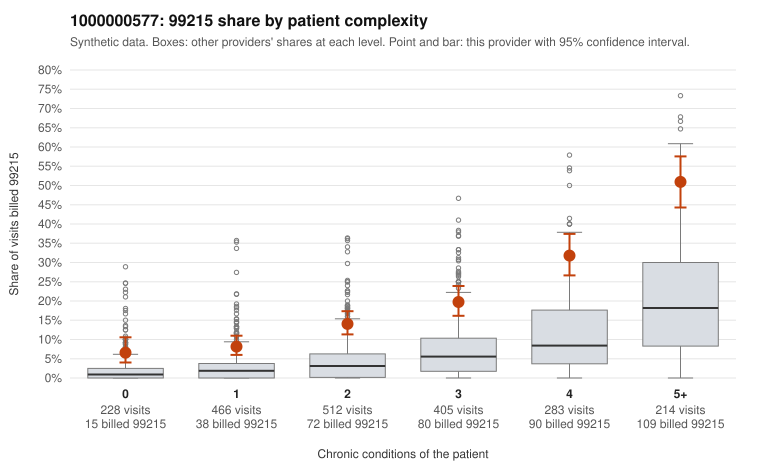

# 1000000577: Provider 1000000577 bills 99215 well above expectation in every complexity tier, even after risk adjustment, but too few charts came back to show whether the notes support the levels.

**Leaning (advisory):** Inconclusive

## Why

1000000577 billed 99215 on 19.2% of 2,108 claims against an expected 4.6% given patient complexity (risk-adjusted score 12.62; plain z-score vs peers 2.73). 13% of this provider's 99215 claims were on patients with 0 or 1 chronic conditions. Records came back for 30 claims. Of 8 documented 99215 claims, 1 (12%) were documented below the billed level, against 9% for the comparison providers. 2 of 19 notes claiming moderate-or-higher data reviewed had no lab or test line on the claim. The by-complexity table argues against a purely sicker-panel explanation: this provider's 99215 share runs roughly two to four times the all-provider share in every tier, including patients with zero or one chronic condition (e.g., C0306892 for back pain, C0306897 for an upper respiratory infection), and 99214 dominates the rest of the mix. That points to a level shift across the whole panel rather than concentration on complex patients. The documentation does not confirm upcoding, though. The unsupported rate on documented 99215 claims is close to the comparison rate, with one shortfall (C0307677, moderate MDM, no time recorded) and several high-MDM supported examples, and the 2 notes claiming moderate-or-higher data reviewed without a lab or test line on the claim are only weak evidence of mismatch. With just 8 documented 99215 claims, the records are too thin to judge either way. A reviewer should first request charts for the low-complexity 99215 claims listed in the packet and check whether the MDM and time support level 5 or show signs of templated or cloned notes. Examples: C0307677: billed 99215; documented MDM level moderate, minutes not recorded. C0306816: billed 99215, patient aged 43 with 1 chronic condition(s) (depression). C0306892: billed 99215, patient aged 47 with 0 chronic condition(s).

## Evidence chart

## Cited claims

`C0307677`, `C0306816`, `C0306892`

## Suggested next steps

- Request records for a larger sample of this provider's 99214 and 99215 claims; what came back is too thin to judge.
- Re-screen the provider once the records arrive.

---
Citations checked: 3/3 valid. Synthetic data. The leaning is advisory; the flag comes from the statistical screen, and no clinical documentation is available beyond the sampled records-review facts shown in the packet.
