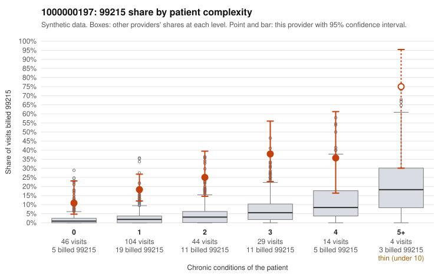

# Payment Integrity dossier: 1000000197

> Draft for human review. Statistical and records-sample evidence only; not a finding. Compliance or legal review is needed before any provider contact, notice or recoupment.

## Provider overview

| | |
|---|---|
| Specialty / state | Family Practice, GA (synthetic) |
| Claims / patients | 241 / 119 |
| Billed mix (99211 to 99215) | 1 / 1 / 51 / 134 / 54 |
| 99215 share | 22.4% |
| Expected 99215 share given patient complexity | 2.7% |
| Screen scores | z vs peers 3.33; risk-adjusted 7.28; flagged by suspicion>=5 |

## Case summary (advisory)

**Provider 1000000197's 99215 share far exceeds what patient complexity predicts, including in low-complexity strata, but documentation is too thin to confirm or refute support for the billed level.**

Leaning: pattern consistent with upcoding. Citations checked: 3/3 valid.

1000000197 billed 99215 on 22.4% of 241 claims against an expected 2.7% given patient complexity (risk-adjusted score 7.28; plain z-score vs peers 3.33). 44% of this provider's 99215 claims were on patients with 0 or 1 chronic conditions. Records came back for 30 claims. Of 2 documented 99215 claims, 0 (0%) were documented below the billed level, against 9% for the comparison providers. 5 of 19 notes claiming moderate-or-higher data reviewed had no lab or test line on the claim. The elevated 99215 rate runs above the all-provider share in every complexity stratum, not just among sicker patients. A large portion of the 99215s fall on patients with zero or one chronic condition, often with routine diagnoses such as hyperlipidemia, hypertension or abdominal pain (e.g., C0098741, C0098757, C0098853, C0098872). That pattern is consistent with upcoding rather than a high-acuity panel. Some of the sampled high-complexity 99215s (e.g., C0098702, C0098728) look clinically plausible. The two documented 99215s, C0098702 and C0098858, were supported at high MDM, but two charts are far too few to judge. C0098858 is a single-condition depression visit, so its high-MDM note deserves a closer look for cloned or templated content. That concern is reinforced, weakly, by the 5 moderate-plus data-reviewed notes with no lab or test line on the claim. A reviewer should first request records for the low-complexity 99215 claims listed in the packet. They should then compare those notes against the documented MDM and time elements, and check for templated language across patients. Examples: C0098732: billed 99215, patient aged 59 with 1 chronic condition(s) (atrial fibrillation). C0098741: billed 99215, patient aged 59 with 0 chronic condition(s). C0098745: billed 99215, patient aged 60 with 1 chronic condition(s) (hyperlipidemia).

## Evidence chart

## Records-review sample so far

Documentation is on file for 30 claims (12% of this provider's claims).

| Billed | Documented | Documentation below billed level | Rate | All-provider rate |
|---|---|---|---|---|
| 99213 | 9 | 0 | 0.0% | 3.0% |
| 99214 | 19 | 0 | 0.0% | 3.3% |
| 99215 | 2 | 0 | 0.0% | 8.7% |

## Recommended next steps for Payment Integrity

1. Request records for the sampled claims in `record_request_list.csv` (31 claims across 99215).
2. Review the records against E/M documentation rules and record the supported level for each claim.
3. Run the overpayment estimator on the reviewed sample (`sampling_plan.md` explains how).
4. Notice, appeal rights, recoupment, education or corrective action, and any referral are decisions for the PI team, compliance and counsel. Nothing here drafts those.

Suggested follow-ups from the case summary:

- Request the full records for the cited claims and have a certified coder re-score each against current E/M documentation rules (medical decision making or total time).
- If the re-scoring confirms the pattern, use the sampling plan in the recovery packet to review a statistical sample of this provider's 99215 claims.
- Check whether notes for the cited claims look copied forward, and whether documented minutes repeat from visit to visit.

## Limits

- Synthetic data; no real claims or providers.
- The leaning is advisory. The flag comes from the statistical screen; the summary explains it.
- The records-review sample is partial and was simulated for this project.
- Allowed amounts are GA Family Practice averages from a public CMS file, not this provider's actual payments.
