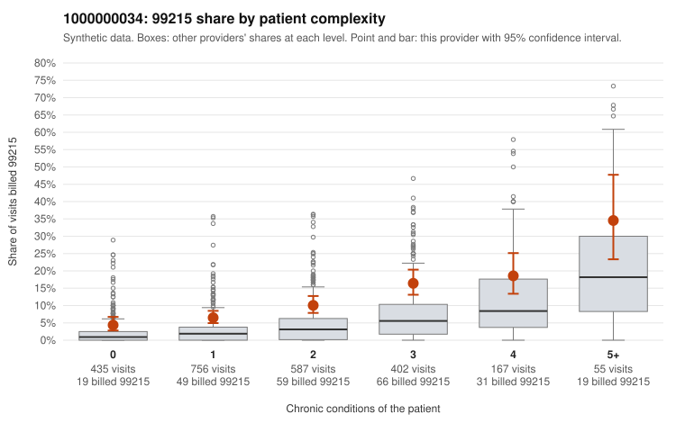

# 1000000034: Provider 1000000034 bills 99215 well above expectation at every complexity level, including on simple acute visits, but the small set of returned charts supports the billed levels, so the pattern cannot yet be called upcoding or a sicker panel.

**Leaning (advisory):** Inconclusive

## Why

1000000034 billed 99215 on 10.1% of 2,402 claims against an expected 3.1% given patient complexity (risk-adjusted score 7.75; plain z-score vs peers 1.04). 28% of this provider's 99215 claims were on patients with 0 or 1 chronic conditions. Records came back for 44 claims. Of 20 documented 99215 claims, 0 (0%) were documented below the billed level, against 9% for the comparison providers. Note checks on 44 returned notes (share showing each sign): problems 16%, late 7%, unsigned 0%, data 9%. No audit trail was received. 4 of 37 notes claiming moderate-or-higher data reviewed had no lab or test line on the claim. The billing pattern points toward upcoding: 99215 share runs roughly double the all-provider rate in every condition-count stratum, not just among complex patients, and the overall mix sits heavily at 99214. The sampled low-complexity 99215s include routine presentations such as upper respiratory infection (C0018976, C0019056, C0019300, C0020567), low back pain (C0020381, C0020582) and urinary infection (C0019003, C0020123), which rarely need high-complexity decision-making. Against this, none of the 20 documented 99215 claims was documented below the billed level. That is reassuring but weak evidence, because records cover under 2% of claims and the all-provider rate would predict only one or two mismatches in a sample that size. Some charts may also be supporting the bill on paper only: low-complexity claims C0019504 and C0020592 are documented as high MDM (C0020592 with no minutes recorded), C0018976 is flagged for a problems-list issue, some notes show repeated times, a few claim moderate-plus data review with no lab line, and no audit trail was received. A reviewer should first pull a larger, targeted chart sample of the low-complexity 99215 claims listed here, check whether their notes are templated or cloned against the presenting problem, and request the EHR audit trail. Examples: C0018505: billed 99215, patient aged 31 with 1 chronic condition(s) (obesity). C0018941: billed 99215, patient aged 43 with 0 chronic condition(s).

## Evidence chart

## Cited claims

`C0018505`, `C0018941`

## Suggested next steps

- 44 charts came back but do not settle it: request a targeted sample of 99215 charts, starting with C0018505, C0018941.
- Re-check after the targeted charts arrive; do not call upcoding or a sicker panel on this evidence alone.

---
Citations checked: 2/2 valid. Synthetic data. The leaning is advisory; the flag comes from the statistical screen, and no clinical documentation is available beyond the sampled records-review facts shown in the packet.
