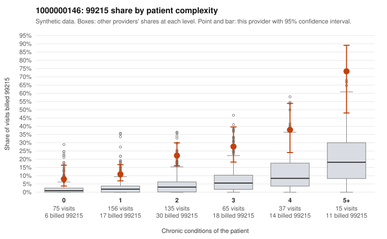

# 1000000146: Provider 1000000146's elevated 99215 billing appears in every complexity tier, including low-complexity patients, but too few charts were reviewed to confirm or rule out upcoding.

**Leaning (advisory):** Inconclusive

## Why

1000000146 billed 99215 on 19.9% of 483 claims against an expected 3.2% given patient complexity (risk-adjusted score 8.14; plain z-score vs peers 2.86). 24% of this provider's 99215 claims were on patients with 0 or 1 chronic conditions. Records came back for 30 claims. Of 5 documented 99215 claims, 0 (0%) were documented below the billed level, against 9% for the comparison providers. Note checks on 30 returned notes (share showing each sign): problems 17%, late 0%, unsigned 0%, data 7%. No audit trail was received. 2 of 24 notes claiming moderate-or-higher data reviewed had no lab or test line on the claim. The 99215 share runs several times the all-provider rate in every complexity tier, including patients with zero conditions, and the overall mix sits heavily at 99214. That pattern looks more like a uniform upward billing habit than a sicker panel, though sicker patients do draw more 99215s here. The documentation does not settle it: none of the 5 documented 99215 claims fell below the billed level, but that sample is too small to judge. Two of the supported 99215s, C0073123 (age 20, no chronic conditions, R10.9) and C0073255 (hyperlipidemia only), are low-complexity visits documented at high MDM, and C0073123 also appears among the note-signal examples for problems and data. That is weak evidence the note may be inflated to match the bill, not proof. A reviewer should first request more charts for the low-complexity 99215 claims listed (such as C0072822, C0072892, C0073090 and C0073319), compare their notes for cloned or templated MDM language given the repeated-time signal, and obtain the missing audit trail. Examples: C0073157: billed 99214; documented MDM level low, 24 minutes. C0072797: billed 99215, patient aged 30 with 1 chronic condition(s) (asthma). C0072820: billed 99215, patient aged 72 with 1 chronic condition(s) (type 2 diabetes).

## Evidence chart

## Cited claims

`C0073157`, `C0072797`, `C0072820`

## Suggested next steps

- 30 charts came back but do not settle it: request a targeted sample of 99215 charts, starting with C0073157, C0072797, C0072820.
- Re-check after the targeted charts arrive; do not call upcoding or a sicker panel on this evidence alone.

---
Citations checked: 3/3 valid. Synthetic data. The leaning is advisory; the flag comes from the statistical screen, and no clinical documentation is available beyond the sampled records-review facts shown in the packet.
