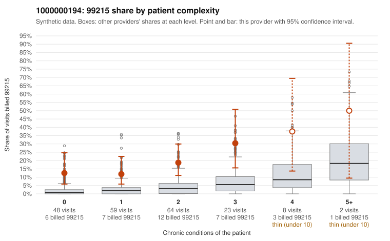

# 1000000194: Provider 1000000194's 99215 rate is elevated in every complexity tier, including patients with no chronic conditions, but the few returned charts support the billed level, so the evidence is mixed.

**Leaning (advisory):** Inconclusive

## Why

1000000194 billed 99215 on 17.6% of 204 claims against an expected 2.6% given patient complexity (risk-adjusted score 5.16; plain z-score vs peers 2.44). 36% of this provider's 99215 claims were on patients with 0 or 1 chronic conditions. Records came back for 30 claims. Of 9 documented 99215 claims, 0 (0%) were documented below the billed level, against 9% for the comparison providers. Note checks on 30 returned notes (share showing each sign): problems 23%, late 3%, unsigned 0%, data 7%. No audit trail was received. 4 of 23 notes claiming moderate-or-higher data reviewed had no lab or test line on the claim. The excess 99215 billing is not concentrated in sicker patients: the share runs several times the all-provider rate even for patients with 0 or 1 conditions, which a high-acuity panel would not explain. Against that, all 9 documented 99215 claims were supported, though 9 charts is too few to clear the pattern. Some supported notes also look questionable. C0097909 (no chronic conditions, UTI diagnosis) and C0097907 (hyperlipidemia plus upper respiratory infection) were documented as high MDM, the 20% duplicate and 12% repeated-time rates suggest possible templated or cloned notes, and 4 notes claiming moderate-or-higher data review had no lab or test line on the claim. Without an audit trail, a reviewer cannot tell whether these notes reflect real complexity or were written to match the billed code. Reviewers should first request more charts and the audit trail for the low-complexity 99215 claims, starting with C0097909, C0097907, C0097770 and C0097773, and compare duplicated note text across visits. Examples: C0097946: billed 99214; documented MDM level low, minutes not recorded. C0097770: billed 99215, patient aged 44 with 0 chronic condition(s). C0097773: billed 99215, patient aged 50 with 0 chronic condition(s).

## Evidence chart

## Cited claims

`C0097946`, `C0097770`, `C0097773`

## Suggested next steps

- 30 charts came back but do not settle it: request a targeted sample of 99215 charts, starting with C0097946, C0097770, C0097773.
- Re-check after the targeted charts arrive; do not call upcoding or a sicker panel on this evidence alone.

---
Citations checked: 3/3 valid. Synthetic data. The leaning is advisory; the flag comes from the statistical screen, and no clinical documentation is available beyond the sampled records-review facts shown in the packet.
