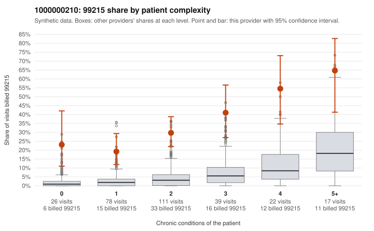

# 1000000210: Provider 1000000210's 99215 rate is elevated in every complexity tier, including patients with no chronic conditions, but the small documented sample supports every billed 99215, leaving the pattern unresolved.

**Leaning (advisory):** Inconclusive

## Why

1000000210 billed 99215 on 31.7% of 293 claims against an expected 3.7% given patient complexity (risk-adjusted score 10.00; plain z-score vs peers 5.08). 23% of this provider's 99215 claims were on patients with 0 or 1 chronic conditions. Records came back for 29 claims. Of 12 documented 99215 claims, 0 (0%) were documented below the billed level, against 9% for the comparison providers. Note checks on 29 returned notes (share showing each sign): problems 17%, late 0%, unsigned 0%, data 0%. No audit trail was received. 2 of 20 notes claiming moderate-or-higher data reviewed had no lab or test line on the claim. The elevation is not explained by a sicker panel: the 99215 share is several times the all-provider share even for 0- and 1-condition patients, and the low-complexity sample includes 99215s for routine acute problems such as URI (C0108913), UTI (C0109000, C0109089) and low back pain (C0108966). Against that, none of the documented 99215s fell below the billed level. However, the records cover only about a tenth of claims, so the documentation is thin rather than reassuring. Several signs suggest the notes may be templated or inflated rather than reflecting the visits: C0109089, a 0-condition UTI visit, was documented as high MDM; most supported examples have no recorded minutes; about 17% of notes carry problem flags (e.g., C0108918, C0108933, C0109000); about 17% repeat time entries; two notes claim moderate-plus data review with no lab or test line; and no audit trail was received. A reviewer should first pull and read the low-complexity 99215 charts (starting with C0109089, C0109000 and C0109138) to judge whether the high-MDM narrative is clinically plausible, then request the audit trail and a larger records sample before choosing between upcoding and supported complex care. Examples: C0108913: billed 99215, patient aged 42 with 0 chronic condition(s). C0108937: billed 99215, patient aged 63 with 1 chronic condition(s) (osteoarthritis).

## Evidence chart

## Cited claims

`C0108913`, `C0108937`

## Suggested next steps

- 29 charts came back but do not settle it: request a targeted sample of 99215 charts, starting with C0108913, C0108937.
- Re-check after the targeted charts arrive; do not call upcoding or a sicker panel on this evidence alone.

---
Citations checked: 2/2 valid. Synthetic data. The leaning is advisory; the flag comes from the statistical screen, and no clinical documentation is available beyond the sampled records-review facts shown in the packet.
