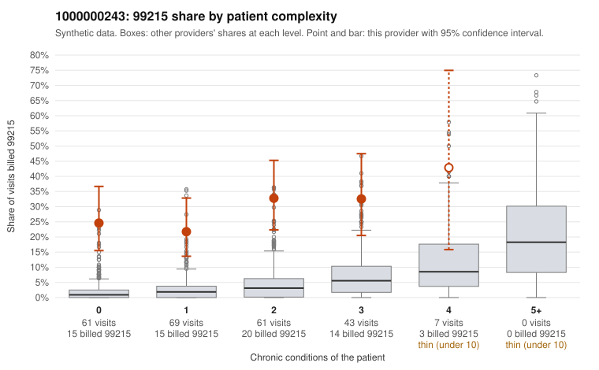

# 1000000243: 1000000243: 6 of 6 documented 99215 claims (100%) are documented below the billed level

**Leaning (advisory):** Pattern consistent with upcoding

## Why

1000000243 billed 99215 on 27.8% of 241 claims against an expected 2.6% given patient complexity (risk-adjusted score 9.64; plain z-score vs peers 4.34). 45% of this provider's 99215 claims were on patients with 0 or 1 chronic conditions. Records came back for 30 claims. Of 6 documented 99215 claims, 6 (100%) were documented below the billed level, against 9% for the comparison providers. Note checks on 30 returned notes (share showing each sign): problems 3%, late 0%, unsigned 0%, data 3%. No audit trail was received. 2 of 14 notes claiming moderate-or-higher data reviewed had no lab or test line on the claim. This pattern is consistent with upcoding. It is a reason to review the records, not a finding. Examples: C0136916: billed 99215; documented MDM level moderate, 39 minutes. C0136980: billed 99215, patient aged 30 with 0 chronic condition(s); documented MDM level moderate, 39 minutes. C0137047: billed 99215; documented MDM level moderate, minutes not recorded. C0136889: billed 99215, patient aged 45 with 0 chronic condition(s). C0136895: billed 99215, patient aged 19 with 0 chronic condition(s). C0136919: billed 99215, patient aged 44 with 0 chronic condition(s).

## Evidence chart

## Cited claims

`C0136916`, `C0136980`, `C0137047`, `C0136889`, `C0136895`, `C0136919`

## Suggested next steps

- Request the full charts for C0136916, C0136980, C0137047 and have a certified coder re-score each against the current E/M rules (medical decision making or total time).
- If the re-scoring confirms the pattern, review the random sample in the recovery packet's sampling plan before any overpayment estimate; do not extrapolate from a targeted sample.
- Look at the notes themselves: 3% address fewer problems than their level implies and 0% were signed late; request the audit trail for C0136916, C0136980, C0137047.

---
Citations checked: 6/6 valid. Synthetic data. The leaning is advisory; the flag comes from the statistical screen, and no clinical documentation is available beyond the sampled records-review facts shown in the packet.
