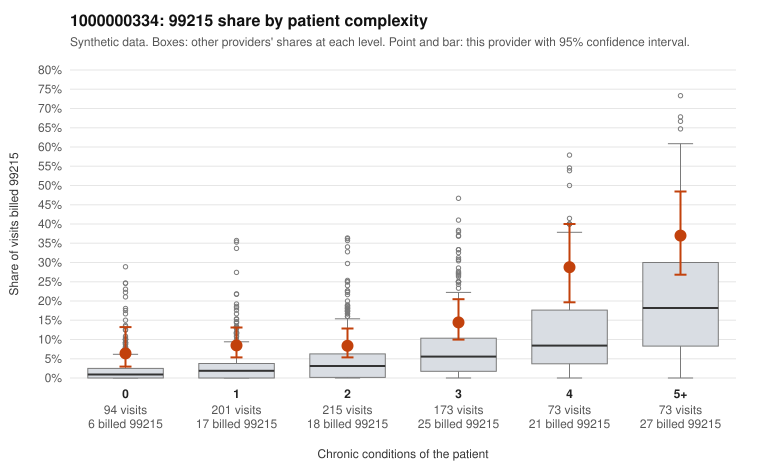

# 1000000334: Provider 1000000334 bills 99215 well above expectation in every complexity band, including low-complexity patients, yet the sampled charts all support the billed level, so the evidence points in two directions.

**Leaning (advisory):** Inconclusive

## Why

1000000334 billed 99215 on 13.8% of 829 claims against an expected 4.2% given patient complexity (risk-adjusted score 5.32; plain z-score vs peers 1.72). 20% of this provider's 99215 claims were on patients with 0 or 1 chronic conditions. Records came back for 45 claims. Of 18 documented 99215 claims, 0 (0%) were documented below the billed level, against 9% for the comparison providers. Note checks on 45 returned notes (share showing each sign): problems 4%, late 9%, unsigned 0%, data 2%. No audit trail was received. 5 of 39 notes claiming moderate-or-higher data reviewed had no lab or test line on the claim. The excess 99215 billing is not confined to sicker patients: the share runs roughly two to four times the all-provider rate even among patients with zero or one chronic condition (e.g., C0185341, C0185668, C0185909, which carry only symptom or acute codes), and the mix is also heavily weighted toward 99214, which is the pattern that would concern a reviewer. Against that, none of the 18 documented 99215 claims were documented below the billed level, and examples such as C0185742, C0186014 and C0186163 show high MDM with substantial recorded time, which is consistent with a legitimately complex panel. Several things limit how much that documentation result can be trusted. Records cover only about 5% of claims. No audit trail was received. The repeated-time rate is notable. A handful of notes claim moderate-or-higher data review with no lab or test on the claim, which is weak evidence that some notes may be templated or inflated. Supported 99215 example C0185318 also appears among the late notes. A reviewer should first request charts specifically for the low-complexity 99215 claims listed in the packet, along with the EHR audit trail, and check whether those notes reflect visit-specific work rather than cloned text or repeated time entries. Examples: C0185361: billed 99213; documented MDM level straightforward, minutes not recorded. C0185301: billed 99215, patient aged 62 with 1 chronic condition(s) (hypertension). C0185341: billed 99215, patient aged 61 with 0 chronic condition(s).

## Evidence chart

## Cited claims

`C0185361`, `C0185301`, `C0185341`

## Suggested next steps

- 45 charts came back but do not settle it: request a targeted sample of 99215 charts, starting with C0185361, C0185301, C0185341.
- Re-check after the targeted charts arrive; do not call upcoding or a sicker panel on this evidence alone.

---
Citations checked: 3/3 valid. Synthetic data. The leaning is advisory; the flag comes from the statistical screen, and no clinical documentation is available beyond the sampled records-review facts shown in the packet.
