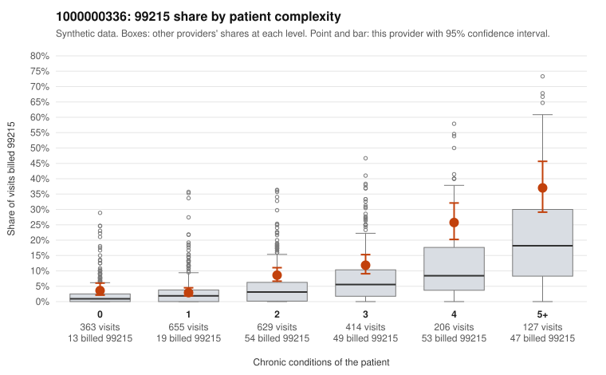

# 1000000336: 1000000336: documented 99215 claims mostly support the level billed (10% below)

**Leaning (advisory):** Pattern consistent with a high-acuity panel

## Why

1000000336 billed 99215 on 9.8% of 2,394 claims against an expected 3.6% given patient complexity (risk-adjusted score 6.31; plain z-score vs peers 0.98). 14% of this provider's 99215 claims were on patients with 0 or 1 chronic conditions. Records came back for 45 claims. Of 20 documented 99215 claims, 2 (10%) were documented below the billed level, against 9% for the comparison providers. Note checks on 45 returned notes (share showing each sign): problems 13%, late 4%, unsigned 0%, data 2%. No audit trail was received. 1 of 33 notes claiming moderate-or-higher data reviewed had no lab or test line on the claim. This pattern is consistent with a high-acuity panel. The sampled documentation supports the billed level. Examples: C0186660: billed 99215, patient aged 42 with 0 chronic condition(s); documented MDM level high, 51 minutes. C0187382: billed 99215; documented MDM level high, minutes not recorded. C0187672: billed 99215; documented MDM level high, 41 minutes. C0186584: billed 99215, patient aged 69 with 5 chronic condition(s) (type 2 diabetes;obesity;hyperlipidemia;COPD;osteoarthritis). C0186935: billed 99215, patient aged 69 with 5 chronic condition(s) (type 2 diabetes;hypertension;COPD;asthma;osteoarthritis).

## Evidence chart

## Cited claims

`C0186660`, `C0187382`, `C0187672`, `C0186584`, `C0186935`

## Suggested next steps

- Do not pursue recovery on this evidence: 45 charts came back and they support the level billed (2 of 20 documented 99215 claims below the billed level).
- Revisit if the 99215 share keeps rising against peers or a larger sample shows unsupported claims.

---
Citations checked: 5/5 valid. Synthetic data. The leaning is advisory; the flag comes from the statistical screen, and no clinical documentation is available beyond the sampled records-review facts shown in the packet.
