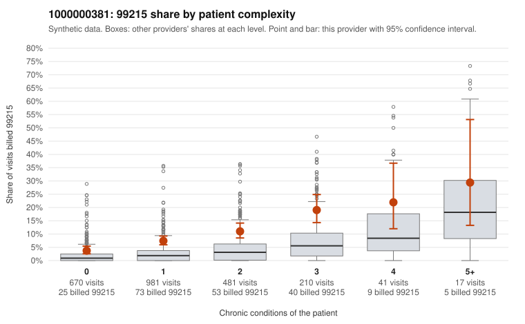

# 1000000381: Provider 1000000381 bills 99215 well above expectation, with nearly half on low-complexity patients, yet the small set of returned charts largely supports the billed level, so the pattern is unresolved.

**Leaning (advisory):** Inconclusive

## Why

1000000381 billed 99215 on 8.5% of 2,400 claims against an expected 2.3% given patient complexity (risk-adjusted score 8.05; plain z-score vs peers 0.74). 48% of this provider's 99215 claims were on patients with 0 or 1 chronic conditions. Records came back for 44 claims. Of 19 documented 99215 claims, 1 (5%) were documented below the billed level, against 9% for the comparison providers. Note checks on 44 returned notes (share showing each sign): problems 27%, late 2%, unsigned 0%, data 7%. No audit trail was received. 3 of 30 notes claiming moderate-or-higher data reviewed had no lab or test line on the claim. The elevated 99215 share holds in every complexity band, not just among sicker patients, and the low-complexity sample includes 99215s for routine presentations such as URI (J06.9 on C0214578, C0214627, C0214667), follow-up visits (Z09 on C0214961, C0216321) and UTI (N39.0 on C0215239, C0216666). That pattern is consistent with upcoding rather than a sicker panel. Against this, the documented 99215 unsupported rate is below the comparison providers', and supported charts include low-complexity claims such as C0216480 (rash, no chronic conditions) documented as high MDM. This is why the case is ambiguous: either the visits were genuinely complex, or the notes are written to match the code. That second possibility cannot be dismissed, because the problems-flag rate is notable, some time entries repeat, a few notes claim moderate-or-higher data review with no lab or test billed, and no audit trail was received to rule out cloned or templated notes. Reviewers should first pull additional charts for the low-complexity 99215s and compare them for templated MDM language and repeated times. They should also request the EHR audit trail to check note creation and copy-paste patterns before relying on the documentation match. Examples: C0214962: billed 99215, patient aged 45 with 1 chronic condition(s) (type 2 diabetes); documented MDM level moderate, minutes not recorded. C0214258: billed 99215, patient aged 48 with 0 chronic condition(s). C0214565: billed 99215, patient aged 33 with 1 chronic condition(s) (hypothyroidism).

## Evidence chart

## Cited claims

`C0214962`, `C0214258`, `C0214565`

## Suggested next steps

- 44 charts came back but do not settle it: request a targeted sample of 99215 charts, starting with C0214962, C0214258, C0214565.
- Re-check after the targeted charts arrive; do not call upcoding or a sicker panel on this evidence alone.

---
Citations checked: 3/3 valid. Synthetic data. The leaning is advisory; the flag comes from the statistical screen, and no clinical documentation is available beyond the sampled records-review facts shown in the packet.
