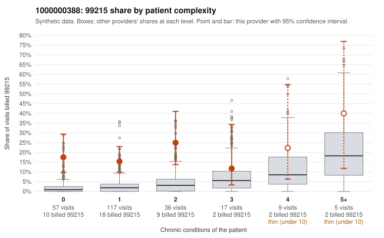

# 1000000388: 1000000388: 12 of 17 documented 99215 claims (71%) are documented below the billed level

**Leaning (advisory):** Pattern consistent with upcoding

## Why

1000000388 billed 99215 on 17.8% of 241 claims against an expected 2.5% given patient complexity (risk-adjusted score 5.97; plain z-score vs peers 2.48). 65% of this provider's 99215 claims were on patients with 0 or 1 chronic conditions. Records came back for 44 claims. Of 17 documented 99215 claims, 12 (71%) were documented below the billed level, against 9% for the comparison providers. Note checks on 44 returned notes (share showing each sign): problems 25%, late 4%, unsigned 0%, data 2%. No audit trail was received. 4 of 32 notes claiming moderate-or-higher data reviewed had no lab or test line on the claim. This pattern is consistent with upcoding. It is a reason to review the records, not a finding. Examples: C0218626: billed 99215, patient aged 96 with 5 chronic condition(s) (obesity;depression;heart failure;asthma;osteoarthritis); documented MDM level moderate, minutes not recorded. C0218679: billed 99215, patient aged 52 with 4 chronic condition(s) (obesity;hyperlipidemia;depression;hypertension); documented MDM level moderate, minutes not recorded. C0218709: billed 99215, patient aged 54 with 0 chronic condition(s); documented MDM level low, 20 minutes. C0218610: billed 99215, patient aged 21 with 0 chronic condition(s); documented MDM level high, minutes not recorded. C0218614: billed 99215, patient aged 21 with 0 chronic condition(s). C0218616: billed 99215, patient aged 44 with 1 chronic condition(s) (osteoarthritis).

## Evidence chart

## Cited claims

`C0218626`, `C0218679`, `C0218709`, `C0218610`, `C0218614`, `C0218616`

## Suggested next steps

- Request the full charts for C0218626, C0218679, C0218709 and have a certified coder re-score each against the current E/M rules (medical decision making or total time).
- If the re-scoring confirms the pattern, review the random sample in the recovery packet's sampling plan before any overpayment estimate; do not extrapolate from a targeted sample.
- Look at the notes themselves: 25% address fewer problems than their level implies and 4% were signed late; request the audit trail for C0218626, C0218679, C0218709.

---
Citations checked: 6/6 valid. Synthetic data. The leaning is advisory; the flag comes from the statistical screen, and no clinical documentation is available beyond the sampled records-review facts shown in the packet.
