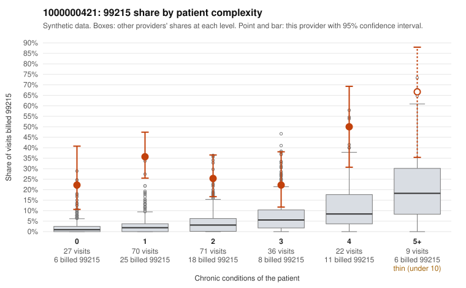

# 1000000421: 1000000421: 5 of 6 documented 99215 claims (83%) are documented below the billed level

**Leaning (advisory):** Pattern consistent with upcoding

## Why

1000000421 billed 99215 on 31.5% of 235 claims against an expected 3.5% given patient complexity (risk-adjusted score 9.15; plain z-score vs peers 5.03). 42% of this provider's 99215 claims were on patients with 0 or 1 chronic conditions. Records came back for 30 claims. Of 6 documented 99215 claims, 5 (83%) were documented below the billed level, against 9% for the comparison providers. Note checks on 30 returned notes (share showing each sign): problems 33%, late 0%, unsigned 0%, data 0%. No audit trail was received. 1 of 22 notes claiming moderate-or-higher data reviewed had no lab or test line on the claim. This pattern is consistent with upcoding. It is a reason to review the records, not a finding. Examples: C0232704: billed 99215; documented MDM level moderate, minutes not recorded. C0232726: billed 99215; documented MDM level moderate, 38 minutes. C0232763: billed 99215, patient aged 71 with 5 chronic condition(s) (type 2 diabetes;obesity;hyperlipidemia;hypertension;osteoarthritis); documented MDM level low, minutes not recorded. C0232721: billed 99215, patient aged 55 with 1 chronic condition(s) (hyperlipidemia). C0232723: billed 99215, patient aged 44 with 1 chronic condition(s) (hypothyroidism). C0232725: billed 99215, patient aged 43 with 1 chronic condition(s) (hypertension).

## Evidence chart

## Cited claims

`C0232704`, `C0232726`, `C0232763`, `C0232721`, `C0232723`, `C0232725`

## Suggested next steps

- Request the full charts for C0232704, C0232726, C0232763 and have a certified coder re-score each against the current E/M rules (medical decision making or total time).
- If the re-scoring confirms the pattern, review the random sample in the recovery packet's sampling plan before any overpayment estimate; do not extrapolate from a targeted sample.
- Look at the notes themselves: 33% address fewer problems than their level implies and 0% were signed late; request the audit trail for C0232704, C0232726, C0232763.

---
Citations checked: 6/6 valid. Synthetic data. The leaning is advisory; the flag comes from the statistical screen, and no clinical documentation is available beyond the sampled records-review facts shown in the packet.
