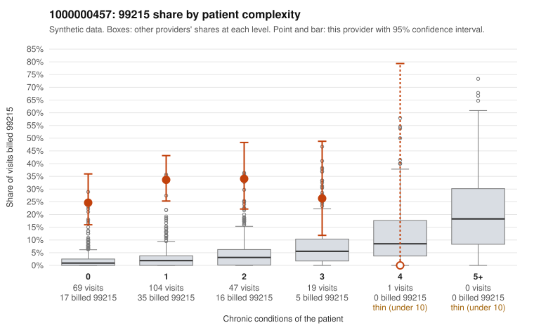

# 1000000457: 1000000457: 0 of 6 documented 99215 claims (0%) are documented below the billed level

**Leaning (advisory):** Pattern consistent with upcoding

## Why

1000000457 billed 99215 on 30.4% of 240 claims against an expected 2.1% given patient complexity (risk-adjusted score 12.03; plain z-score vs peers 4.83). 71% of this provider's 99215 claims were on patients with 0 or 1 chronic conditions. Records came back for 24 claims. Of 6 documented 99215 claims, 0 (0%) were documented below the billed level, against 9% for the comparison providers. Note checks on 24 returned notes (share showing each sign): problems 38%, late 12%, unsigned 0%, data 17%. No audit trail was received. 4 of 19 notes claiming moderate-or-higher data reviewed had no lab or test line on the claim. This pattern is consistent with upcoding. It is a reason to review the records, not a finding. Examples: C0250557: billed 99213; documented MDM level straightforward, minutes not recorded. C0250529: billed 99215, patient aged 42 with 1 chronic condition(s) (hypothyroidism). C0250530: billed 99215, patient aged 48 with 0 chronic condition(s). C0250535: billed 99215, patient aged 72 with 1 chronic condition(s) (hypertension).

## Evidence chart

## Cited claims

`C0250557`, `C0250529`, `C0250530`, `C0250535`

## Suggested next steps

- Request the full charts for C0250557, C0250529, C0250530 and have a certified coder re-score each against the current E/M rules (medical decision making or total time).
- If the re-scoring confirms the pattern, review the random sample in the recovery packet's sampling plan before any overpayment estimate; do not extrapolate from a targeted sample.
- Look at the notes themselves: 38% address fewer problems than their level implies and 12% were signed late; request the audit trail for C0250557, C0250529, C0250530.

---
Citations checked: 4/4 valid. Synthetic data. The leaning is advisory; the flag comes from the statistical screen, and no clinical documentation is available beyond the sampled records-review facts shown in the packet.
