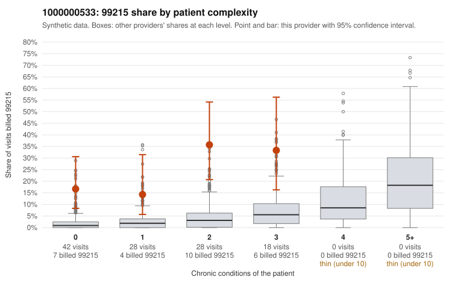

# 1000000533: 1000000533: too few returned records to judge

**Leaning (advisory):** Inconclusive

## Why

1000000533 billed 99215 on 23.3% of 116 claims against an expected 2.3% given patient complexity (risk-adjusted score 5.89; plain z-score vs peers 3.49). 41% of this provider's 99215 claims were on patients with 0 or 1 chronic conditions. Records came back for 45 claims. Of 20 documented 99215 claims, 1 (5%) were documented below the billed level, against 9% for the comparison providers. Note checks on 45 returned notes (share showing each sign): problems 27%, late 7%, unsigned 0%, data 0%. No audit trail was received. 0 of 32 notes claiming moderate-or-higher data reviewed had no lab or test line on the claim. The evidence does not support a call either way yet. Examples: C0285967: billed 99215; documented MDM level moderate, minutes not recorded. C0285973: billed 99215, patient aged 48 with 0 chronic condition(s). C0285995: billed 99215, patient aged 66 with 0 chronic condition(s); documented MDM level high, 45 minutes.

## Evidence chart

## Cited claims

`C0285967`, `C0285973`, `C0285995`

## Suggested next steps

- 45 charts came back but do not settle it: request a targeted sample of 99215 charts, starting with C0285967, C0285973, C0285995.
- Re-check after the targeted charts arrive; do not call upcoding or a sicker panel on this evidence alone.

---
Citations checked: 3/3 valid. Synthetic data. The leaning is advisory; the flag comes from the statistical screen, and no clinical documentation is available beyond the sampled records-review facts shown in the packet.
