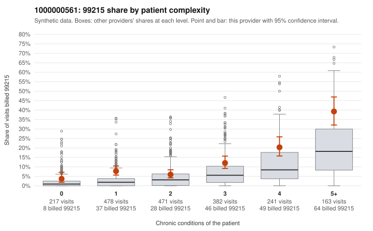

# 1000000561: 1000000561: documented 99215 claims mostly support the level billed (6% below)

**Leaning (advisory):** Pattern consistent with a high-acuity panel

## Why

1000000561 billed 99215 on 11.9% of 1,952 claims against an expected 4.3% given patient complexity (risk-adjusted score 6.45; plain z-score vs peers 1.37). 19% of this provider's 99215 claims were on patients with 0 or 1 chronic conditions. Records came back for 45 claims. Of 18 documented 99215 claims, 1 (6%) were documented below the billed level, against 9% for the comparison providers. Note checks on 45 returned notes (share showing each sign): problems 24%, late 2%, unsigned 0%, data 4%. No audit trail was received. 3 of 40 notes claiming moderate-or-higher data reviewed had no lab or test line on the claim. This pattern is consistent with a high-acuity panel. The sampled documentation supports the billed level. Examples: C0297092: billed 99215; documented MDM level high, 46 minutes. C0297152: billed 99215, patient aged 37 with 0 chronic condition(s); documented MDM level high, minutes not recorded. C0297834: billed 99215; documented MDM level high, minutes not recorded. C0296670: billed 99215, patient aged 76 with 5 chronic condition(s) (hypothyroidism;obesity;hypertension;atrial fibrillation;chronic kidney disease). C0297230: billed 99215, patient aged 77 with 5 chronic condition(s) (hypothyroidism;type 2 diabetes;depression;hypertension;atrial fibrillation).

## Evidence chart

## Cited claims

`C0297092`, `C0297152`, `C0297834`, `C0296670`, `C0297230`

## Suggested next steps

- Do not pursue recovery on this evidence: 45 charts came back and they support the level billed (1 of 18 documented 99215 claims below the billed level).
- Revisit if the 99215 share keeps rising against peers or a larger sample shows unsupported claims.

---
Citations checked: 5/5 valid. Synthetic data. The leaning is advisory; the flag comes from the statistical screen, and no clinical documentation is available beyond the sampled records-review facts shown in the packet.
